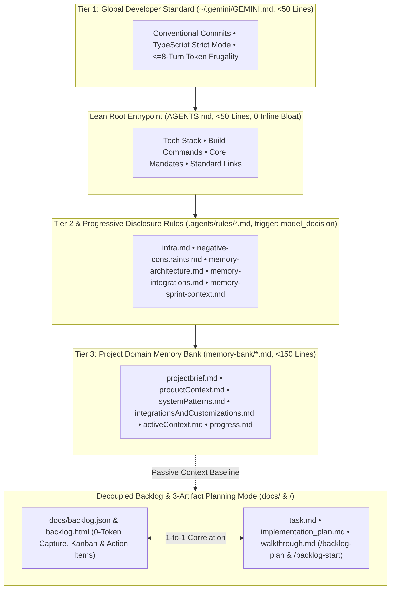
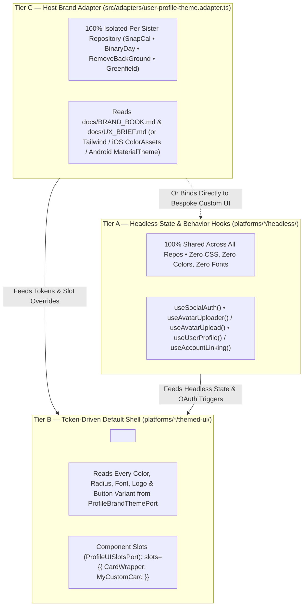
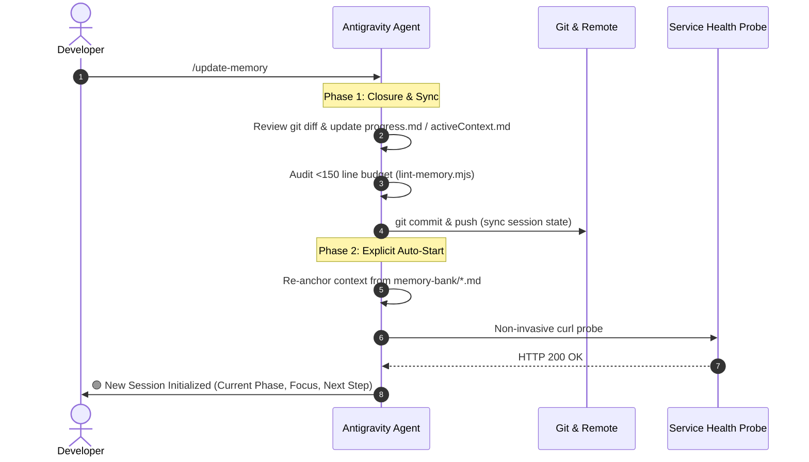
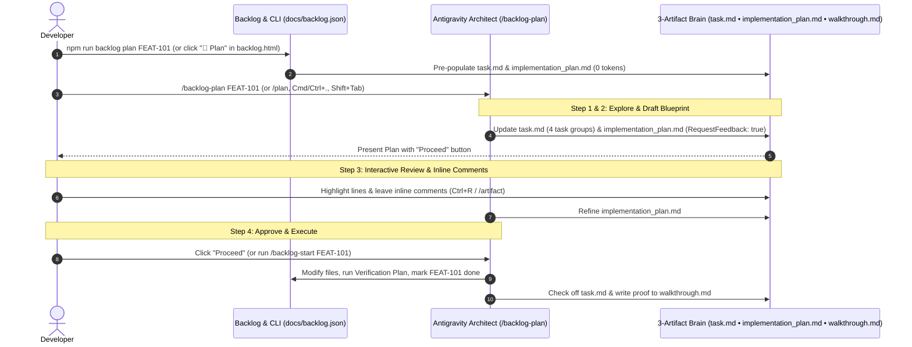

# Antigravity Memory Bank 🧠

[](LICENSE)
[](https://github.com/johnny-saigon/antigravity-memory-bank/actions)

A production-tested **Three-Tier Memory Bank** brick, **Decoupled Zero-Token Backlog Engine**, **Correlated 3-Artifact Planning Mode**, and **Antigravity Plugin** for autonomous, context-aware AI pair programming.

Eliminates context drift, prevents cross-database contamination, enforces token limits (`< 150 lines` per document and `< 24 KB` expanded rule cap), correlates **Antigravity Planning Mode (`task.md`, `implementation_plan.md`, `walkthrough.md`)** 1-to-1 with your local backlog (`docs/backlog.json`), and enables continuous session cycling without manual restarts.

---

## 🏛️ The Three-Tier Memory & Correlated Planning Architecture



### 🛡️ Feature Guide 1: Using Native Rule Discovery & `model_decision` Progressive Disclosure (`FEAT-118`)

Traditional `memory-bank/` setups fail in Antigravity because of three native discovery traps—all of which `antigravity-memory-bank` automatically prevents, heals, and lints:

| Trap | Why It Happens in Antigravity | How `antigravity-memory-bank` Fixes It Automatically |
| :--- | :--- | :--- |
| **1. Silent Discard Trap** | Antigravity only scans `AGENTS.md`, `GEMINI.md`, or immediate `.md` children inside `.agents/rules/*.md`. It ignores standalone `memory-bank/*.md` files and nested subdirectories (like `.agents/rules/ios/swift.md`) unless registered in `.agents/rules.json`. | Automatically generates top-level progressive-disclosure rule bridges in `.agents/rules/` (`memory-architecture.md`, `memory-integrations.md`, `memory-sprint-context.md`) and auto-registers any nested `.agents/rules/<subdir>/` in `.agents/rules.json`. |
| **2. Broken Frontmatter Trap** | If a file in `.agents/rules/*.md` is missing YAML frontmatter or uses camelCase (`modelDecision` instead of `model_decision`), Antigravity silently discards the file. | Generates, auto-heals, and lints every `.agents/rules/*.md` file with strict snake_case `trigger: model_decision` + `description: "..."` YAML frontmatter. |
| **3. Token Bloat Trap** | Dumping project memory into `GEMINI.md` or using `@[...](memory-bank/...)` inline expansions inside root `AGENTS.md` injects 15KB+ of memory on every single turn. | Enforces a strict **`< 50 lines`** cap on root `AGENTS.md` and `~/.gemini/GEMINI.md` (with `0` inline `@`-expansions), loading `memory-bank/*.md` on demand via `trigger: model_decision`. |

#### Step-by-Step: How to Use Progressive Disclosure Rules & Verify with `/context`

1. **Keep Root `AGENTS.md` & `~/.gemini/GEMINI.md` Under 50 Lines**:
   - Only place your tech stack, build/test commands, repo structure, core operational mandates, and standard markdown links (`[Project Brief](memory-bank/projectbrief.md)`) in `AGENTS.md`.
   - **Never** use `@[Label](memory-bank/...)` inside root `AGENTS.md`.
2. **Add Domain or Platform Rules in `.agents/rules/*.md` with `model_decision` Frontmatter**:
   - Create or edit `.md` files in `.agents/rules/` using snake_case `trigger: model_decision` and a clear `description` telling Antigravity when to activate the rule:
     ```markdown
     ---
     trigger: model_decision
     description: "Apply whenever fixing bugs, handling API errors, or updating state management in iOS or Android."
     ---
     # Known Project Pitfalls & Architectural Decisions
     - Never use synchronous network calls in view controllers.
     - Auth tokens refresh via `AuthInterceptor.ts`; do not write custom retry loops in UI components.
     ```
   - Convert repetitive multi-step workflows (like generating boilerplate or running test suites) into **Skills** (`.agents/skills/<name>/SKILL.md`) rather than rules.
3. **Auto-Bridge & Auto-Heal Custom Rules (`npm run memory:sync`)**:
   - Whenever you add a new domain file in `memory-bank/*.md` or a rule in `.agents/rules/`, run:
     ```bash
     npm run memory:sync
     ```
   - This automatically links custom `memory-bank/*.md` files into `.agents/rules/memory-architecture.md`, fixes any missing/camelCase frontmatter in `.agents/rules/*.md`, and registers any nested `.agents/rules/<subdir>/` folders in `.agents/rules.json`.
4. **Verify Active Rules & Token Footprint in Chat (`/context`)**:
   - Inside any Antigravity session, type:
     ```text
     /context
     ```
   - Antigravity will explicitly list which `.agents/rules/*.md` files are active and how many tokens each rule consumes.
5. **Audit via the CLI Linter (`npm run lint:memory`)**:
   ```bash
   npm run lint:memory
   ```
   Verifies `< 150 lines` per `memory-bank/*.md` file, `<= 50 lines` on root `AGENTS.md` (0 inline `@`-expansions), valid `trigger: model_decision` YAML frontmatter across all `.agents/rules/*.md` files, and `0` unindexed rule subdirectories.

---

### 💰 Feature Guide 2: How to Use the "Stop the Credit Bleed" Controls (`FEAT-119`)

Treat Antigravity as your hands-on execution engineer rather than an unconstrained researcher. Follow this 5-step workflow on every task to cap per-turn token and credit consumption:

#### 1. One-Time Setup: Disable the Overage Toggle & Check `/credits` / `/usage`
- Open your **Google One / Antigravity Settings** and turn **OFF** the **"Toggle for overage"**. This ensures Antigravity hits a hard stop at your 20x baseline limit instead of silently burning paid top-up credits.
- Anytime during a session, inspect which models are draining your pool by running:
  ```text
  /credits
  /usage
  ```

#### 2. Lock Down `/plan` Before Coding Complex Features or Multi-File Bugs
- Never let Antigravity jump straight into editing production files on complex features or multi-file bugs. Reviewing and correcting a text plan costs a fraction of a credit; reverting 5 broken file edits costs 10x more.
- **In Chat**:
  ```text
  /backlog-plan FEAT-101
  # Or use native Planning Mode:
  /plan
  ```
- **In Terminal (`0 Tokens`)**:
  ```bash
  npm run backlog plan FEAT-101
  ```
- Review `<brainDir>/implementation_plan.md` (or click **`📐 Plan`** in `backlog.html`), leave inline comments on specific lines if needed, and click **Proceed** (or run `/backlog-start FEAT-101`) only after the plan is locked down.

#### 3. Throttle Reasoning Depth with `/effort`
- You do not need maximum frontier reasoning for boilerplate UI, routing, CSS tweaks, or simple CRUD endpoints.
- Before kicking off a task, set thinking effort to match the task complexity:
  ```text
  # For boilerplate UI, routing, copy updates, or simple CRUD endpoints:
  /effort low
  /effort medium

  # Reserve high effort ONLY for complex state machines, concurrency, or multi-service architecture:
  /effort high
  ```

#### 4. Execute Within the Hard Turn Budget (`≤ 8 Tool Turns per Fix`)
- When you run `/backlog-start <TICKET_ID>`, Mandate #8 enforces:
  1. **Memory-First Lookup**: Reads `memory-bank/activeContext.md` and `docs/backlog.json` first—never re-investigating already recorded state.
  2. **Zero `transcript.jsonl` or Sibling Repo Scraping**: Never reads `.system_generated/logs/transcript*.jsonl` or greps colocated sibling repos (`BinaryDay`, `SnapCal`, `RemoveBackGround`, `AntigravityRemote`) unless explicitly asked.
  3. **Batched Execution (`≤ 8 Tool Turns`)**: Batches all file reads into `1` turn, all edits into `1–2` turns, and all verification/deployment commands into `1–2` chained shell calls.

#### 5. Prune Context Aggressively After Every Sub-Task (`/clear`, `/compact` & `/context`)
- Carrying a 50,000-token history of an old build error into a new task means paying for those 50,000 tokens on every subsequent keystroke.
- Immediately after finishing a sub-task or bug fix (when `/backlog-start` or `/update-memory` prints the completion banner):
  ```text
  # Option A (Recommended): Clear thread history completely and re-anchor in ~8k tokens (~95% cost reduction):
  /clear
  /start

  # Option B: Compress current conversation history in place:
  /compact

  # Inspect currently loaded files and active rules anytime:
  /context
  ```

---

### 🧱 Feature Guide 3: How the Pluggable UX/UI & Branding Architecture Works (`FEAT-120`)

Every new (`init`) or existing (`upgrade`) installation of `antigravity-memory-bank` automatically installs [`docs/BRICK_ARCHITECTURE_GUIDE.md`](templates/docs/BRICK_ARCHITECTURE_GUIDE.md) and the progressive-disclosure rule [`.agents/rules/brick-governance.md`](templates/rules/brick-governance.md.tpl), enabling **Shared Hexagonal Bricks** (such as `bricks/user-profile` with 4-provider Google, Facebook, Apple, and Microsoft OAuth).

We split every brick's presentation layer into **3 decoupled tiers** across **Web, iOS, and Android**:



#### 1. Tier A — Headless State & Behavior Hooks (`platforms/*/headless/`)
- **100% shared across all repos.**
- Handles form validation, loading/error states, OAuth redirect/popup triggers (`useSocialAuth()`), optimistic avatar cropping/upload (`useAvatarUploader()` / `useAvatarUpload()`), and account-linking confirmation modals (`useUserProfile()` / `useAccountLinking()` / `useProfileSettings()`).
- **Zero CSS, zero colors, zero fonts.**

#### 2. Tier B — Token-Driven Default Shell (`platforms/*/themed-ui/`)
- Shared layout primitives that consume a `<ProfileThemeProvider slots={customSlots} theme={hostTheme}>` (and `ProfileThemeConfiguration.swift` on iOS / `ProfileThemeTokens.kt` on Android).
- Every color, border radius, typography scale, spacing unit, app logo, and social button variant (`pill`, `outline`, `icon-only`, `dark`/`light`) is read from a strict **`ProfileBrandThemePort`** contract.
- **Supports Component Slots (`ProfileUISlotsPort` — Slot Overrides)**: If `RemoveBackGround` wants a completely custom glassmorphic Card wrapper or custom header while keeping the brick's form internals and OAuth buttons, it simply passes `slots={{ CardWrapper: MyCustomCard }}` without touching the brick's source code.

#### 3. Tier C — Host Brand Adapter (`src/adapters/user-profile-theme.adapter.ts`)
- **100% isolated per sister repository.**
- Lives in `SnapCal`, `BinaryDay`, `RemoveBackGround`, or any greenfield project. Reads that specific project's `docs/BRAND_BOOK.md` / `docs/UX_BRIEF.md` (or Tailwind/CSS variables / iOS `ColorAssets` / Android `MaterialTheme`) and feeds them into the brick.

#### 🚀 Bonus: How to Plug in a Brand New UX/UI Redesign Later (in Any Repo)
Because `src/adapters/user-profile-theme.adapter.ts` and the `headless/` hooks are 100% isolated from the brick's core logic, whenever you design a new UI mockup (e.g., from Figma or Stitch) for `BinaryDay`, `SnapCal`, `RemoveBackGround`, or any new repo in the future:

1. **Attach the UX/UI `.zip` bundle or screenshot offline at `0` token cost**:
   ```bash
   npm run backlog add "Apply New Brand UX/UI to User Profile" --type feature --priority medium
   npm run backlog attach FEAT-105 ./path/to/new-profile-ui.zip
   ```
2. **Run `/backlog-plan FEAT-105`**. The agent will update **only** `src/adapters/user-profile-theme.adapter.ts` (or drop custom slot components into `slots={{ ... }}`), leaving **100% of your 4 OAuth logins, security logic, and database adapters untouched!**

Full documentation is automatically installed in [`docs/BRICK_ARCHITECTURE_GUIDE.md`](templates/docs/BRICK_ARCHITECTURE_GUIDE.md).

---

### 📚 Feature Guide 4: Canonical Living Documentation Hierarchy & Deep Universal Harvester (`FEAT-121`)

To keep `memory-bank/*.md` strictly under **150 lines** (`Passive Observer Invariant`) while ensuring zero architectural, UX, security, or QA detail is ever lost, `antigravity-memory-bank` includes a unified **Canonical Living Documentation Hierarchy & Deep Universal Harvester** ([`scripts/sync-living-docs.mjs`](scripts/sync-living-docs.mjs)) bridged on demand via [`.agents/rules/docs-living-specs.md`](templates/rules/docs-living-specs.md.tpl) (`trigger: model_decision`).

#### 1. The 10 Canonical Living Documents (`docs/INDEX.md` + 4 Pillars)

| Pillar | Canonical Living Document | What the Harvester Populates & Consolidates (`0 AI Tokens`) |
| :--- | :--- | :--- |
| **Navigation Hub** | [`docs/INDEX.md`](docs/INDEX.md) | Master TOC, real-time status badges (`🟢 Populated & Auto-Synced` vs `🟡 Progressive Scaffold`), and index of archived legacy specs (`docs/archive/`). |
| **1. Architecture** | [`docs/architecture/LOGICAL_ARCHITECTURE.md`](docs/architecture/LOGICAL_ARCHITECTURE.md) | System context, Mermaid flows, installed Hexagonal Bricks (`bricks/*/brick.json`), progressive `FEAT-*` capability map, and harvested domain sections from `README.md` & `memory-bank/projectbrief.md`. |
| **1. Architecture** | [`docs/architecture/TECHNICAL_ARCHITECTURE.md`](docs/architecture/TECHNICAL_ARCHITECTURE.md) | Stack matrix, HTTP routes (`app/**/route.ts`, `pages/api/**`, Fastify/Express), CLI binaries, mobile URL schemes (`app.json`, `Info.plist`, `AndroidManifest.xml`), Prisma models (`model <Name>`), SQL tables (`CREATE TABLE`), and harvested `systemPatterns.md` / `infrastructureInvariants.md`. |
| **1. Architecture** | [`docs/architecture/SECURITY_AND_COMPLIANCE.md`](docs/architecture/SECURITY_AND_COMPLIANCE.md) | OAuth 2.0 / PKCE / Apple `5.1.1(v)` / Meta GDPR rules, masked `.env*` variable contracts (secrets redacted), and harvested `SECURITY.md` & `integrationsAndCustomizations.md`. |
| **2. Design & UX** | [`docs/design/DESIGN.md`](docs/design/DESIGN.md) | Unified Design System & Stitch-ready specification automatically synthesized from `BRAND_BOOK.md`, `UX_BRIEF.md`, discovered codebase tokens/screens, and all harvested design documents. |
| **2. Design & UX** | [`docs/design/UX_BRIEF.md`](docs/design/UX_BRIEF.md) | Target platforms, discovered Web/iOS/Android screens & components (`.tsx`, `.swift`, `.kt`), attached UX `.zip` bundles (`docs/attachments/`), and harvested `productContext.md`. |
| **2. Design & UX** | [`docs/design/BRAND_BOOK.md`](docs/design/BRAND_BOOK.md) | `ProfileBrandThemePort` (`--ag-profile-*`) & `ProfileUISlotsPort` contracts, plus discovered CSS variables and `#hex` tokens from `*theme*`, `tailwind.config.*`, and `.css` files. |
| **3. Quality & QA** | [`docs/quality/TEST_PLAN_AND_SUITES.md`](docs/quality/TEST_PLAN_AND_SUITES.md) | Mandatory Dual-Test & Live E2E gates (Mandate #6) and auto-discovered unit, contract, and E2E test suites (`**/*.test.*`, `**/*.spec.*`). |
| **3. Quality & QA** | [`docs/quality/BUG_FIX_RECORDS.md`](docs/quality/BUG_FIX_RECORDS.md) | Root-cause analysis (RCA) log correlated with `BUG-*` tickets in `docs/backlog.json`, `fix:` Git commits, and consolidated legacy `BUG_FIX_RECORDS.md` files. |
| **4. Operations** | [`docs/operations/MIGRATION_AND_RELEASE_LOG.md`](docs/operations/MIGRATION_AND_RELEASE_LOG.md) | Completed milestones, installed Hexagonal Bricks, SQL/Prisma schema migrations, and harvested `CHANGELOG.md` & `memory-bank/progress.md`. |

#### 2. How the Deep Universal Harvester Works on Existing & Greenfield Projects
1. **Universal 8-Pillar Markdown Crawler & Classifier (`classifyMarkdownDocument`)**:
   - Relocates loose root `.md` specs into `docs/` and crawls **all** non-preserved Markdown files in `docs/**/*.md` (including custom filenames and nested subfolders like `docs/specs/STRIPE_BILLING_API.md` or `docs/guides/OAUTH_SECURITY_FLOW.md`).
   - Scores filenames, `#`/`##` headings, and domain keywords across the 8 canonical pillars, merges full content into `<!-- ag-section:legacy-*:start -->` with **zero content loss**, moves original files to `docs/archive/`, and automatically rewrites all relative and `file://` Markdown links across the repository.
2. **Non-Destructive In-Place Section Harvester (`harvestInPlaceRepoKnowledge`)**:
   - Reads `README.md`, `SECURITY.md`, `CHANGELOG.md`, and `memory-bank/*.md` without moving or modifying them, routing high-signal domain sections into `<!-- harvested-repo-context:start -->` blocks inside each canonical document with clickable provenance links.
3. **Deep Codebase AST/Regex Harvesters (`extractCodebaseFacts`)**:
   - Scans Next.js App Router (`app/**/route.ts`), Pages Router (`pages/api/**`), Fastify/Express routes, Prisma `model` definitions, SQL `CREATE TABLE` statements, Zod/validator schemas, mobile `Info.plist`/`AndroidManifest.xml` schemes, masked `.env*` keys, CSS/Tailwind tokens, and test suites.

#### 3. How to Activate & Run the Doc Structure and Harvester

- **A. Automatic Activation on New (`init`) or Existing (`upgrade` / `organize`) Projects**:
  The doc structure creation and deep harvester run **automatically** whenever you initialize, upgrade, or organize a repository:
  ```bash
  # On a new or existing project (from GitHub via npx):
  npx --yes github:johnny-saigon/antigravity-memory-bank init -y
  npx --yes github:johnny-saigon/antigravity-memory-bank upgrade -y

  # Or inside a project with antigravity-memory-bank already installed:
  npm run memory:upgrade -- -y
  npm run memory:organize
  ```
- **B. Manual On-Demand Execution & Linting Anytime (`0 AI Tokens`)**:
  After installation or upgrade, you can trigger the harvester or verify link integrity at any time using the installed `package.json` scripts or CLI:
  ```bash
  # Re-scan all docs/**/*.md, README.md, memory-bank/*.md, routes, schemas & tokens:
  npm run docs:sync
  # (or: node scripts/sync-living-docs.mjs)

  # Audit that all 9 canonical living docs exist and 0 broken links exist in docs/INDEX.md:
  npm run docs:lint
  # (or: node scripts/sync-living-docs.mjs --lint)
  ```
- **C. Continuous Lifecycle Auto-Sync**:
  Once installed, the harvester also triggers automatically in the background whenever:
  - You plan or complete a ticket (`npm run backlog plan <ID>` / `npm run backlog done <ID>`),
  - You run `npm run memory:sync` (or `/update-memory`), or
  - `.git/hooks/post-commit` and `.agents/hooks.json` execute after code changes.

---

## 🛡️ Core Invariant: Passive Observer & Listener Only

A foundational separation of concerns governs the Three-Tier Memory Bank:
> **The Memory Bank (`memory-bank/*.md`) is strictly a passive context baseline and observer. It is NOT an operational backlog, issue tracker, or work surface.**

1. **Independent Reference Baseline**: The Memory Bank exists purely to provide immutable architectural ground truth, domain taxonomies, and high-level milestones when an Antigravity agent boots a session (`/start`).
2. **Separation of Dev Operations**: Active engineering tasks, sprint boards, migration checklists, and bug fix logs belong in the project's documentation directory (`docs/MIGRATION_BOARD.md`, `docs/BUG_FIX_RECORDS.md`, `docs/BACKLOG.md`), **never** inside `memory-bank/`.
3. **Passive Reflection**: When code is committed or `/update-memory` runs, the memory system passively observes Git commits and `docs/` records, reflecting high-level summaries and verification stamps into `memory-bank/*.md`. It never conducts active ticket operations.

---

## ⚡ 3. How to Use the Installer

### A. On-the-Fly Installation in Existing Projects (Active Antigravity Window)

If you are already working inside an active Antigravity session on an existing project (e.g. **`BinaryDay`**, **`RemoveBackGround`**, or any local repository connected to GitHub), you can activate the Memory Bank instantly with **zero IDE restart**:

```bash
# Automated on-the-fly execution (auto-detects project stack, git remotes, and ports):
npx github:johnny-saigon/antigravity-memory-bank init -y --commit

# Or via universal one-line shell installer:
curl -fsSL https://raw.githubusercontent.com/johnny-saigon/antigravity-memory-bank/main/install.sh | bash -s -- -y --commit
```

#### Why It Works on the Fly:
Antigravity dynamically ingests workspace rules (`AGENTS.md`, `.agents/rules/`) and workspace skills (`.agents/skills/start`, `.agents/skills/update-memory`) as soon as they appear in the project root.
- **Immediate in-chat activation**: Run the command in your terminal or prompt the agent to execute it, and you can invoke `/start` immediately in the same conversation!
- **Non-destructive**: Preserves any existing custom `AGENTS.md` guidelines while injecting the Memory Bank links and rules.
- **Git synchronization**: When `--commit` is passed, automatically stages and commits the memory baseline to Git, ready to `git push origin main` to GitHub.

---

### B. Interactive Scaffolding for New or Custom Projects

Inside your target repository root, run the CLI interactively:

```bash
npx github:johnny-saigon/antigravity-memory-bank init
```

The CLI inspects `package.json`, `.git/config`, and environment files, presenting auto-detected values in brackets as defaults—simply press `ENTER` to accept:
- **Project Name & Tagline**: Auto-extracted from `package.json` or git remote.
- **Target Platforms**: Web, iOS, Android, CLI, Monorepo (auto-detects Expo, Next.js, etc.).
- **Tech Stack**: Frontend, Backend, Database, Cache (auto-detects Fastify, React, Prisma, pg, etc.).
- **Allocated Port & Health URL**: Internal port allocation and health probe endpoint for automated verification.

It automatically scaffolds and pre-populates:
- `memory-bank/*.md` (7 specialized context documents including `integrationsAndCustomizations.md`, all strictly `< 150 lines`)
- `AGENTS.md` (Top-level agent directives, context bootstrap links, and auto-balanced `< 24 KB` rule shards)
- `.agents/rules/` (Tier 2 infrastructure & negative constraint deny-lists)
- `.agents/skills/` (`/start`, `/backlog-plan`, `/backlog-start`, and `/update-memory` continuous lifecycle skills)
- `.agents/hooks.json` & `.git/hooks/post-commit` (On-the-fly lifecycle hooks for `SessionStart`, `PostToolUse`, and `Stop`)
- `docs/backlog.json`, `docs/BACKLOG.md`, & `docs/backlog.html` (Zero-token local backlog & Review Pane Kanban board)
- `docs/planning/{task.md, implementation_plan.md, walkthrough.md}` & `<brainDir>/{task.md, implementation_plan.md, walkthrough.md}` (Correlated **3-Artifact Planning Mode**, automatically pre-populated with existing project info for advanced projects)
- `docs/BACKLOG_GUIDE.md` & `docs/PLANNING_GUIDE.md` (Complete user guides for Backlog & Planning Mode)
- `scripts/lint-memory.mjs`, `scripts/sync-memory-context.mjs`, & `scripts/backlog.mjs` (Automated line-budget enforcer, incremental context sync, and backlog/planning engine)

#### 🔍 Automated Historical Context Scraping & Planning Pre-Population:
During new project initialization (`init`) or upgrade (`upgrade`), the installer **scrapes all prior build history, documentation, `.env*` contracts, MCP configs, and Antigravity conversation transcripts** to construct an accurate baseline:
1. **Antigravity Conversation Transcripts (`~/.gemini/antigravity/brain/`)**: Scans past agent transcripts for the project, extracting recent accomplishments, technical decisions, and pending backlog tasks.
2. **Project Documentation & Existing Boards**: Ingests `docs/**/*.md` (`BUG_FIX_RECORDS.md`, `MIGRATION_BOARD.md`, `BACKLOG.md`, `DESIGN.md`) and `README.md`, adapting existing tickets into `docs/backlog.json`.
3. **API Keys, MCP Servers & Customizations**: Indexes `.env*` variable names (with secret masking), active MCP servers (`~/.gemini/config/mcp_config.json`), and workspace rules/skills into `memory-bank/integrationsAndCustomizations.md`.
4. **Git Commit History & 3-Artifact Planning Pre-Population**: Parses commit logs (`feat:`, `fix:`, releases) and pre-populates **`task.md`**, **`implementation_plan.md`**, and **`walkthrough.md`** so already-advanced projects immediately have a structured architectural blueprint without starting from blank files.
5. **10-Point Mandatory Baseline Ingestion Checklist**: Verifies all 10 baseline invariants (`10/10 Passed`) before completing installation.

This ensures that the initialized Memory Bank and Planning Mode are **never empty placeholders**, but rather a rich, fully populated reflection of your codebase's real state from day one.

---

### C. Installing as an Antigravity Plugin

Clone directly into the project's `.agents/plugins/` directory:

```bash
mkdir -p .agents/plugins
git clone https://github.com/johnny-saigon/antigravity-memory-bank.git .agents/plugins/memory-bank
```

Or install globally across all projects on your machine:

```bash
mkdir -p ~/.gemini/config/plugins
git clone https://github.com/johnny-saigon/antigravity-memory-bank.git ~/.gemini/config/plugins/memory-bank
```

Antigravity automatically loads the bundled plugin assets:
- **Manifest**: `plugin.json` (declares `/start`, `/backlog-plan`, `/backlog-start`, and `/update-memory`)
- **Bundled Skills**: `skills/start/SKILL.md`, `skills/backlog-plan/SKILL.md`, `skills/backlog-start/SKILL.md`, and `skills/update-memory/SKILL.md`
- **Bundled Directives**: `rules/AGENTS.md` (Three-Tier Memory Hierarchy & Correlated Planning Mode rules)

> [!TIP]
> For active workspaces in ongoing pair-programming sessions, **Option A (Workspace Brick)** is recommended because its skills and rules activate **immediately on the fly** without restarting the IDE. **Option C (Plugin)** is ideal for machine-wide standardization across restarts.

---

### D. Upgrading Earlier Implementations (BinaryDay, RemoveBackGround, SnapCal, AntigravityRemote)

If a project already has an earlier implementation of the Memory Bank, run the **in-place, non-destructive upgrade**:

```bash
# Inside BinaryDay, RemoveBackGround, SnapCal, or any installed repo root:
npx github:johnny-saigon/antigravity-memory-bank upgrade -y --commit

# Or via package.json script:
npm run memory:upgrade

# Or via universal one-liner:
curl -fsSL https://raw.githubusercontent.com/johnny-saigon/antigravity-memory-bank/main/install.sh | bash -s -- upgrade -y --commit
```

#### What the Upgrade Does:
1. **100% Domain Context Preservation**: All existing custom markdown documents in `memory-bank/` (`projectbrief.md`, `systemPatterns.md`, `psychometrics.md`, etc.) and Tier 2 cluster invariants (`.agents/rules/infra.md`) remain untouched.
2. **Installs & Pre-Populates Correlated 3-Artifact Planning Mode**: Installs `/backlog-plan` (`.agents/skills/backlog-plan/SKILL.md`), `docs/PLANNING_GUIDE.md`, and `npm run backlog:plan`, and automatically fills `docs/planning/{task.md, implementation_plan.md, walkthrough.md}` and `<brainDir>/{task.md, implementation_plan.md, walkthrough.md}` with your project's existing architecture, active `in_progress`/`todo` backlog tickets, and completed milestones.
3. **Synchronizes Integrations & On-the-Fly Lifecycle Hooks**: Configures `.agents/hooks.json` (`SessionStart`, `PostToolUse`, `Stop`) and updates `memory-bank/integrationsAndCustomizations.md` with your latest `.env*` keys, MCP servers, and skills.
4. **Upgrades `AGENTS.md` & Skills**: Updates operational mandates (including On-the-Fly Context Registration, Strict End-to-End Verification Before Closure, and 3-Artifact Planning Mode Correlation) and auto-balances rule shards under the `< 24 KB` cap.
5. **Installs & Runs the 10-Point Verification Checklist & Linter**: Audits `< 150 lines` across all `memory-bank/*.md` files and verifies `10/10` on the Mandatory Baseline Ingestion Checklist.
6. **Adds Complete Lifecycle & Backlog Scripts to `package.json`**:
   - `npm run backlog:plan`: Generates/focuses the 3 Planning Mode artifacts (`task.md`, `implementation_plan.md`, `walkthrough.md`).
   - `npm run backlog:render`: Refreshes the Review pane Kanban board and Planning Mode artifacts.
   - `npm run lint:memory`: Audits token line counts (`< 150 lines`).
   - `npm run memory:sync`: Incrementally syncs commits, env keys, and MCP configs.
   - `npm run memory:upgrade`: Pulls the latest upstream Memory Bank & Planning Mode features.
   - `npm run memory:export` / `npm run memory:uninstall`: Exports or cleanly uninstalls the brick with zero context loss.
7. **Git Synchronization**: When `--commit` is passed, commits the upgrade cleanly into version control.

---

## 📦 4. Context Export & Clean Deinstallation

### A. Exporting Project Memory & Context
You can export the entire project memory bank at any time into a human-readable consolidated snapshot and a compressed raw backup archive:

```bash
# Standalone export command:
npx github:johnny-saigon/antigravity-memory-bank export

# Or via universal one-liner:
curl -fsSL https://raw.githubusercontent.com/johnny-saigon/antigravity-memory-bank/main/install.sh | bash -s -- export
```

Outputs generated in `./memory-backups/`:
1. **Consolidated Markdown** (`memory-bank-export-YYYYMMDD-HHmmss.md`): Single consolidated document containing a table of contents, timestamps, and full text of all memory-bank files, rules, and skills. Ideal for sharing with external models, code review, or pasting into team wikis.
2. **Compressed Archive** (`memory-bank-backup-YYYYMMDD-HHmmss.tar.gz`): Bit-for-bit compressed tarball of `memory-bank/`, `AGENTS.md`, and `.agents/` for instant restoration anytime.

---

### B. Clean Deinstallation (Zero Context Loss)

To completely remove the Memory Bank from a project while **guaranteeing that all project memory is preserved**:

```bash
# Interactive deinstallation (prompts for confirmation):
npx github:johnny-saigon/antigravity-memory-bank uninstall

# Automated on-the-fly deinstallation with Git commit:
npx github:johnny-saigon/antigravity-memory-bank uninstall -y --commit
```

#### What the Deinstallation Workflow Does:
1. **Automated Safety Export**: Automatically performs a full context export (`.md` and `.tar.gz`) into `./memory-backups/` *before* deleting any files (unless explicitly bypassed with `--no-export`).
2. **Targeted Artifact Cleanup**:
   - Deletes `memory-bank/`.
   - Deletes `.agents/skills/start/` and `.agents/skills/update-memory/` (leaves unrelated custom skills intact).
   - Deletes `.agents/rules/infra.md` and `.agents/rules/negative-constraints.md` (leaves other rules intact).
   - Deletes `scripts/lint-memory.mjs`.
   - Cleans `"lint:memory"` from `package.json` scripts.
   - Cleans or removes `AGENTS.md` (preserves any custom project instructions).
   - Cleans `.agents/plugins/memory-bank` if installed in plugin mode.
3. **Git Commit**: When `--commit` is passed, records the deinstallation into Git:
   `chore(memory): cleanly deinstall Antigravity Memory Bank (context archived)`.

---

## 🔄 The Continuous Session Lifecycle

Unlike legacy memory systems that require stopping and manually restarting, this brick uses a **2-Phase Continuous Loop**:



### The Two-Phase Lifecycle Breakdown
Whenever `/update-memory` is triggered (or when a major milestone completes):

#### Phase 1: Milestone Closure & Git Synchronization
1. **Git Diff & Status Review**: Inspects working tree changes (`git status -s` and `git diff --stat`) to verify what was modified.
2. **Context & Progress Updates**: Marks finished acceptance criteria in `memory-bank/progress.md` (`[x]`) and records architectural decisions, schema migrations, and resolved bugs in `memory-bank/activeContext.md`.
3. **Token Line Budget Audit**: Automatically verifies that every file in `memory-bank/*.md` remains strictly **`< 150 lines`** (via `scripts/lint-memory.mjs`). If a domain expands, it splits into a linked sub-file (`@[Topic](path.md)`).
4. **Infrastructure Invariant Verification**: Checks that no Tier 2 cluster invariants (`.agents/rules/infra.md`), port allocations, or database boundaries were violated.
5. **Git Commit & Push**: Stages and commits memory updates with Conventional Commits (e.g. `docs(memory-bank): sync session state and close milestone`) and pushes to the remote branch.

#### Phase 2: Explicit Auto-Start & Cycle Bootstrap
6. **Context Re-Anchoring**: Re-reads `memory-bank/activeContext.md` and `memory-bank/progress.md` to identify the next priority tasks.
7. **Cleanliness & Head Check**: Confirms working tree cleanliness (`git status -s`) and head commit (`git log -n 1 --oneline`).
8. **Live Service Health Probing**: Executes a non-invasive health check against the target API/service (e.g. `curl -s http://<host>:<port>/health`).
9. **Active Session Status Banner**: Immediately outputs the fresh 3-bullet status summary without requiring the developer to manually type `/start`:
   - 🟢 **New Session Cycle Initialized**
   - **Current Phase**: [Current project phase from activeContext.md]
   - **Immediate Focus**: [Top pending task / feature / bug in progress]
   - **Proposed Next Action**: [Concrete first step ready for execution]

---

## 📏 Token Efficiency & The 150-Line Budget

Large context dumps degrade LLM reasoning and balloon context consumption. Every document in `memory-bank/` must stay **under 150 lines**.

Run the built-in linter anytime:
```bash
npm run lint:memory
```

When a topic expands, split it into a linked sub-file:
```markdown
@[Vision Taxonomy](memory-bank/visionTaxonomy.md)
```

---

## ⚡ Automated Self-Updating Architecture

Once installed, the system keeps itself continuously up-to-date across **two distinct dimensions**:

### 1. Context Auto-Updating (Codebase & Commit Synchronization)
- **Git `post-commit` Hook**: Installed into `.git/hooks/post-commit`. Every `git commit` that introduces new features (`feat:`) or bug fixes (`fix:`) automatically triggers `scripts/sync-memory-context.mjs` in the background. It updates `progress.md` accomplishments and `activeContext.md` sprint state with zero manual typing.
- **Agent Continuous Cycle (`/update-memory`)**: When pair-programming with Antigravity, the agent executes the 2-phase lifecycle upon task completion—synchronizing diffs, verifying line budgets (< 150 lines), committing to Git, and auto-bootstrapping the next cycle.
- **CI Context Verification (GitHub Actions)**: `.github/workflows/memory-bank-sync.yml` runs on every PR and push to `main`, validating line budgets (`npm run lint:memory`) and ensuring master branch context is in lockstep with releases.

```bash
# Manually trigger an incremental context sync anytime:
npm run memory:sync

# Or commit automatically with context updates:
npx github:johnny-saigon/antigravity-memory-bank sync --commit
```

### 2. Tooling & System Auto-Updating (Upstream Brick Upgrades)
- **Non-Destructive In-Place Upgrade**: Upstream enhancements, new skills, and prompt optimizations in `antigravity-memory-bank` can be pulled non-destructively:
  ```bash
  npm run memory:upgrade
  ```
  This updates `.agents/skills/`, `scripts/lint-memory.mjs`, and `.git/hooks/post-commit` while keeping all project-specific domain documents in `memory-bank/*.md` 100% intact.

---

## 📋 4. Decoupled Zero-Token Backlog Engine & Review Pane Integration

Capturing backlog ideas, organizing sprints, or updating task statuses through conversational LLM prompts consumes **15,000 to 35,000 prompt tokens** per interaction (due to system instructions, memory files, tool definitions, and chat history).

The **Antigravity Memory Bank** decouples **task capture** from **agent execution**, saving up to **90% of AI credits**:

```
┌────────────────────────────────────────────────────────────────────────┐
│                        1. OFFLINE CAPTURE (0 TOKENS)                   │
│                                                                        │
│   • Local CLI: npm run backlog add "..."                               │
│   • Direct Edit: docs/backlog.json                                     │
│   • In-Pane Form: Click "➕ Quick Capture Task" in Review pane         │
│                                                                        │
│   ──► Updates docs/backlog.json & docs/MIGRATION_BOARD.md              │
│   ──► Automatically refreshes Review Pane HTML & MD artifacts          │
└──────────────────────────────────┬─────────────────────────────────────┘
                                   │
                                   ▼
┌────────────────────────────────────────────────────────────────────────┐
│                  2. ANTIGRAVITY REVIEW PANE VIEW                       │
│                                                                        │
│   • Interactive Kanban Board (backlog.html) in the auxiliary pane      │
│   • Live keyword search, priority filters, component tags              │
│   • 1-Click "🤖 Kickoff Prompt" copies frugal trigger to clipboard     │
└──────────────────────────────────┬─────────────────────────────────────┘
                                   │
                                   ▼
┌────────────────────────────────────────────────────────────────────────┐
│                 3. FRUGAL AGENT EXECUTION (MINIMAL TOKENS)             │
│                                                                        │
│   • Slash Command: /backlog-start <TICKET_IDS>                         │
│   • Agent reads spec from docs/backlog.json without chat iteration     │
│   • Memory bank stays < 150 lines (passive observer, ~1.5k tokens)     │
│   • Deterministic unit tests verify code without LLM hallucination     │
│   • Automated closure, git commit, push & work recap                   │
└────────────────────────────────────────────────────────────────────────┘
```

### Clean Separation, Tight Integration & Uncompromising Execution Quality
1. **Clean Separation**: The Memory Bank (`memory-bank/*.md`) remains strictly a passive architectural context baseline (< 150 lines per file). Active operational tasks and sprint state live in `docs/backlog.json` and `docs/MIGRATION_BOARD.md`.
2. **Frugal on Context Re-Ingestion, Uncompromising on Execution Quality**: Token frugality applies strictly to eliminating redundant context re-ingestion, chat-based ticket management, and bloated memory files—freeing the token budget for deep reasoning, thorough root-cause analysis, complete edge-case coverage, and rigorous test verification.
3. **Tight Integration**: The agent uses `docs/backlog.json` as its direct execution contract, and upon task completion automatically updates both the local backlog (`DONE`) and the passive memory bank (`progress.md` accomplishments).

### Local Backlog CLI (0 Tokens / 0 Credits)
```bash
# View all backlog tasks (or filter: todo, in_progress, high, done)
npm run backlog:list

# Fast offline task capture:
npm run backlog:add "Implement Apple HealthKit Sleep Sync"

# Detailed task capture with priority and component targeting:
npm run backlog add "Push Notification Quick Actions" \
  --type feature \
  --priority high \
  --desc "Allow snoozing or completing reminders directly from banner" \
  --components "src/notifications.ts,src/services/push.ts"

# Update task status:
npm run backlog:status FEAT-101 in_progress
npm run backlog:done FEAT-101
```

### The `/backlog-start` Slash Command & Automated Work Recap
In Antigravity chat, trigger autonomous, context-frugal sprint execution with a single slash command:

```text
/backlog-start FEAT-101
# Or multiple tickets in a single sprint:
/backlog-start FEAT-101, BUG-102
```

The agent autonomously executes a 3-phase cycle:
1. **Phase 1 (Task Activation — 0 Context Waste)**: Ingests the specification directly from `docs/backlog.json`, sets status to `in_progress`, and refreshes the Review pane.
2. **Phase 2 (Context-Frugal, Uncompromising-Quality Execution)**: Enters directly at the target components (avoiding blind repo sweeps), thoroughly inspects all connected callers and contracts, obeys Tier 2 cluster invariants, and runs full test suites for deterministic verification.
3. **Phase 3 (Automated Closure & Recap)**:
   - Marks the ticket `done` in `docs/backlog.json` and migration boards.
   - Updates `memory-bank/progress.md` accomplishments and verifies the `< 150 lines` limit.
   - Refreshes the Review pane Kanban board (`backlog.html`).
   - Commits changes with Conventional Commits and pushes to `origin/main`.
   - Displays a comprehensive, human-readable **Work Recap Banner** with changed files, test results, and next available tickets.

Full documentation is available in [`docs/BACKLOG_GUIDE.md`](templates/docs/BACKLOG_GUIDE.md).

---

## 📐 5. Structured Planning Mode (`Explore → Plan → Execute`) & 3-Artifact Lifecycle

In Antigravity, **Planning Mode** transforms the agent from an immediate code generator into an autonomous software architect that explores your codebase, maps out dependencies, and aligns with you on an architectural blueprint *before* touching a single production file.

Every project initialized (`init`) or updated (`upgrade`) with `antigravity-memory-bank` automatically installs all **Planning Mode** prerequisites (`/backlog-plan` skill, `docs/PLANNING_GUIDE.md`, `npm run backlog:plan`, and the `📐 Plan` Kanban actions) and correlates the **3-Artifact Lifecycle** 1-to-1 with your **Local Backlog (`docs/backlog.json`)** and **Three-Tier Memory Bank (`memory-bank/*.md`)**.



---

### 5.1 How the Planning Mode Workflow Operates

When you trigger Planning Mode (by selecting **Planning** in the mode picker, pressing **`Cmd/Ctrl + .`** or **`Shift + Tab`**, typing **`/plan`**, or invoking **`/backlog-plan <TICKET_ID>`**), Antigravity moves through a structured **3-Artifact Lifecycle** stored inside its session brain (`~/.gemini/antigravity/brain/<session-id>/`) and mirrored in `docs/planning/`:

1. **Context Discovery & `task.md` Creation (`docs/planning/task.md` & `<brainDir>/task.md`):**
   The agent searches your repository, reads your project rules (`GEMINI.md` and `AGENTS.md`), ingests `memory-bank/*.md` and `docs/backlog.json`, and updates **`task.md`**—a live checklist broken into 4 correlated task groups:
   - **1. Context Discovery & Architectural Baseline**
   - **2. Active Sprint & Planning Focus (`In Progress`)**
   - **3. Queued Backlog & Next Implementation Wave (`To-Do`)**
   - **4. Completed & Verified Engineering Tasks (`Done`)**
2. **Drafting `implementation_plan.md` (`docs/planning/implementation_plan.md` & `<brainDir>/implementation_plan.md`):**
   Instead of writing code right away, the agent compiles its findings into a formal design document (`implementation_plan.md`). When your Artifact Review Policy is set to **Request Review** (or `RequestFeedback: true`), the agent pauses execution and presents the plan with a **Proceed** button.
3. **Interactive Review & Iteration:**
   You review the plan, highlight specific lines to leave **Google Docs-style inline comments**, or reply in chat. The agent re-enters Planning Mode, researches any new constraints you pointed out, and updates `implementation_plan.md`.
4. **Execution & `walkthrough.md` (`docs/planning/walkthrough.md` & `<brainDir>/walkthrough.md`):**
   Once you click **Proceed** (or run `/backlog-start <TICKET_ID>`), the agent switches to Execution Mode, checks off items in `task.md` in real time as it modifies files, runs verification tests, marks the ticket `done` in `docs/backlog.json`, and concludes by generating **`walkthrough.md`**—a cumulative summary of all changes made and proof of verification.

---

### 5.2 Automatic Pre-Population for Already-Advanced Projects (`init` & `upgrade`)

If you install (`init`) or update (`upgrade`) `antigravity-memory-bank` on an **already-advanced project** (such as `SnapCal`, `RemoveBackGround`, or `BinaryDay`), you never start with empty planning templates:
- The engine automatically extracts your **Project North Star** (`memory-bank/projectbrief.md`), **Current Phase & Sprint Objective** (`memory-bank/activeContext.md`), **Tier 2 Infrastructure Guardrails** (`.agents/rules/infra.md`), **Active & Queued Backlog Tickets** (`docs/backlog.json`), and **Completed Milestones & Test Matrix** (`memory-bank/progress.md`).
- It immediately populates `docs/planning/{task.md, implementation_plan.md, walkthrough.md}` and `<brainDir>/{task.md, implementation_plan.md, walkthrough.md}` so all projects share the exact same structured architecture from day one.
- **Non-Destructive Inline Edit Protection**: Auto-generated planning artifacts carry an `<!-- antigravity-planning-sync -->` header. If you or the agent manually customize `implementation_plan.md` without that marker, automatic background renders preserve your manual edits until you explicitly run `npm run backlog plan <ID>` or pass `--force`.

---

### 5.3 Anatomy of an `implementation_plan.md`

Understanding how `antigravity-memory-bank` structures `implementation_plan.md` tells you exactly where to look when reviewing a feature or bug fix:

| Section | What the Agent Puts Here | What You Should Check |
| :--- | :--- | :--- |
| **1. Goal Description** | Concise summary of the problem, North Star context from `memory-bank/`, and what the target backlog ticket(s) accomplish. | Verify the agent understood your core user journey and architectural constraints. |
| **2. User Review Required** | Highlighted with `IMPORTANT` or `WARNING` callouts. Lists breaking changes, Tier 2 cluster invariants, unverified assumptions, or **Strict Live E2E Verification** warnings for OAuth/third-party integrations. | **Read this first.** If the agent had to guess on an App Group name, API payload format, or external credential, it flags it here. |
| **3. Proposed Changes** | Files grouped logically by ticket/module (dependencies first), marked with `[NEW]`, `[MODIFY]`, or `[DELETE]`, plus targeted code diffs for key interfaces or schemas. | Check for "scope creep" (files the agent shouldn't touch) or missing edge cases (e.g., forgetting to update `Info.plist`, entitlements, or `.env.example`). |
| **4. Verification Plan** | Concrete terminal commands (unit tests, typechecks, build scripts, live health probes) and manual/E2E testing steps the agent will run after coding. | Ensure the build/test commands match your actual local and production environment so the agent can self-heal any compiler or test errors. |

---

### 5.4 Step-by-Step Usage Guide (CLI, Review Pane Kanban & Chat)

#### A. Offline CLI Planning (`0 AI Tokens`)
```bash
# Synchronize all 3 Planning Mode artifacts with docs/backlog.json and memory-bank/*.md:
npm run backlog:plan

# Focus implementation_plan.md and task.md on one or more specific tickets (and copy /backlog-plan <ID> to clipboard):
npm run backlog plan FEAT-101
npm run backlog plan FEAT-101, BUG-102

# Force-regenerate planning artifacts even if manually edited:
npm run backlog plan FEAT-101 --force
```

#### B. Interactive Review Pane Kanban (`backlog.html`)
1. Open `backlog.html` in the Antigravity Review pane (or browser).
2. At the top of the board, the **3-Artifact Planning Lifecycle Bar** displays live status badges for `task.md`, `implementation_plan.md`, and `walkthrough.md`, plus a **`🔄 Sync 3 Planning Artifacts`** button.
3. On any active ticket card, click **`📐 Plan`**:
   - Calls the local bridge (`POST http://127.0.0.1:4199/api/plan`) to focus `implementation_plan.md` and `task.md` on that ticket.
   - Copies `/backlog-plan <TICKET_ID>` directly to your native OS clipboard (`pbcopy`) so you can paste it into Antigravity chat in one keystroke.

#### C. In Antigravity Chat (`/backlog-plan` → Review → `/backlog-start`)
```text
# 1. Generate & refine the architectural plan for a ticket (pauses for review):
/backlog-plan FEAT-101

# 2. Or pass an attached UX/UI .zip bundle or @file reference into the plan:
/backlog-plan FEAT-101 @src/services/
```
After reviewing `implementation_plan.md` (and leaving any inline comments), click **Proceed** or run:
```text
/backlog-start FEAT-101
```

---

### 5.5 Best Practices for Planning Mode

1. **Separate Exploration from Planning on Unfamiliar Code (`Explore → Plan → Execute`)**:
   - **Step 1 (Explore)**: *"Explain how image uploads and deep links are currently routed in `@src/`."*
   - **Step 2 (Plan)**: Once the agent maps the exact files into its context window, run `/backlog-plan <ID>` or `/plan` with your feature prompt. The resulting `implementation_plan.md` will be grounded in your actual architecture rather than generic boilerplate.
2. **Anchor Context with `@`-Mentions, Visuals & UX/UI `.zip` Bundles**:
   - Use **`@file` or `@directory` autocomplete** in your prompt to point directly to existing state managers, API clients, or configuration files.
   - Copy UI mockups, Xcode error screenshots, or architecture diagrams and press **`Cmd+V` / `Ctrl+V`** directly into the prompt box, or attach `.zip` bundles offline via `npm run backlog attach <ID> <path>` (or the `📎` button in `backlog.html`).
3. **Use Inline Artifact Comments Instead of Long Chat Replies**:
   - Open the `implementation_plan.md` artifact (click it in the IDE Review panel, or press **`Ctrl+R`** / type **`/artifact`** in the CLI).
   - **Highlight the exact file path or proposed function signature** and attach an inline comment (e.g., *"Use `UserDefaults(suiteName:)` here instead of Keychain"*). Inline comments bind your feedback to the exact line of the plan, preventing the agent from accidentally rewriting sections you already approved.
4. **Enforce a Strict Verification Loop in the Plan**:
   - Before clicking **Proceed**, check Section 4 (**Verification Plan**) at the bottom of `implementation_plan.md`. If it looks vague, leave an inline comment specifying the exact terminal command (e.g., *"Run `xcodebuild -scheme SnapCal -sdk iphonesimulator build`"* or *"Run `npm test`"*).
   - For tickets involving OAuth or external APIs, Mandate #6 enforces that tickets remain `in_progress` until live server credentials and end-to-end provider HTTP requests pass.
5. **Bake Recurring Constraints into `GEMINI.md` or `AGENTS.md`**:
   - If you find yourself leaving the same review comments on every `implementation_plan.md` (such as *"Never use deprecated iOS APIs"* or *"Always validate external payloads with Zod"*), add them to `AGENTS.md` or `memory-bank/systemPatterns.md`. Antigravity loads these automatically at session start and applies them while drafting the initial plan.
6. **Use `/fork` When Weighing Two Architectural Approaches**:
   - If you aren't sure whether Approach A or Approach B is better, run **`/fork`** from your approved baseline thread to spin up a parallel branch of the session, test the execution, and run **`/resume`** to jump back to your clean baseline thread if needed.

Full documentation is available in [`docs/PLANNING_GUIDE.md`](templates/docs/PLANNING_GUIDE.md).

---

## 🗂️ 6. AI-Native Repository Blueprint & Automatic Root Reorganization (`organize`)

Modern software development with autonomous AI coding agents works best when the repository root is kept strictly limited to entrypoints (`AGENTS.md`, `README.md`, `package.json`, `.gitignore`, and compiler/framework configs), while passive memory, operational backlogs, planning artifacts, and living specifications each live in dedicated, predictable directories.

Every time you run `init`, `upgrade`, or `organize`, `antigravity-memory-bank` automatically enforces this **Best-Practices AI-Native Repository Structure**—both as a fresh scaffold on a new project and as a non-destructive adapter on an existing codebase:

```text
<project-root>/
├── AGENTS.md                        # Tier 3 AI Agent Entrypoint & Operational Mandates (<24KB expanded)
├── README.md                        # Human & GitHub Repository Landing Page
├── package.json                     # Lifecycle, Backlog, Planning & Memory CLI scripts
├── .gitignore                       # Hardened AI-native ignore rules (ignores docs/backlog.html, memory-backups/, .env*, .DS_Store)
├── .agents/                         # Antigravity IDE Customizations
│   ├── hooks.json                   # Real-time SessionStart / PostToolUse / Stop auto-sync hooks
│   ├── rules/                       # Tier 2 guardrails (infra.md, negative-constraints.md, <24KB memory shards)
│   └── skills/                      # Slash commands (/start, /backlog-plan, /backlog-start, /update-memory)
├── .github/workflows/               # CI/CD & Memory Bank line-budget enforcement (memory-bank-sync.yml)
├── memory-bank/                     # Tier 3 Passive Context Baseline (<150 lines/file, 0 operational tickets)
│   ├── projectbrief.md
│   ├── productContext.md
│   ├── systemPatterns.md
│   ├── infrastructureInvariants.md
│   ├── integrationsAndCustomizations.md
│   ├── activeContext.md
│   └── progress.md
├── docs/                            # Operational Backlog, 3-Artifact Planning & Living Architecture/UX Specs
│   ├── backlog.json                 # Single source of truth for sprint tickets
│   ├── BACKLOG.md                   # Auto-rendered Markdown sprint board (or MIGRATION_BOARD.md)
│   ├── BACKLOG_GUIDE.md             # Zero-token backlog usage guide
│   ├── PLANNING_GUIDE.md            # Explore -> Plan -> Execute guide
│   ├── planning/                    # Correlated 3-Artifact Planning Mode (task.md, implementation_plan.md, walkthrough.md)
│   ├── attachments/                 # Ticket context bundles & extracted UX/UI mockups
│   └── *.md                         # All living specs (UX_BRIEF.md, DESIGN.md, ARCHITECTURE.md, BRAND_BOOK.md, etc.)
├── scripts/                         # Zero-dependency automation & ops scripts (backlog.mjs, lint-memory.mjs, sync-memory-context.mjs)
├── src/ | apps/ | server/ | lib/    # Adaptive application source code (auto-detected archetype)
└── tests/                           # Automated unit & E2E verification suites
```

### How It Works on Fresh Installs vs. Existing Projects

1. **Adaptive Archetype Detection (`detectRepoArchetype`)**:
   Automatically classifies the project into one of 5 archetypes:
   - **`monorepo`** (`apps/*`, `packages/*`, or `workspaces` in `package.json`, e.g., `SnapCal`)
   - **`fullstack-hybrid`** (`src/` + `server/`, e.g., `RemoveBackGround`, `Binaryday`)
   - **`cli-library`** (`bin/` + `lib/`, e.g., `antigravity-memory-bank`)
   - **`web-app`** (`src/`, `app/`, or `pages/`, e.g., `AntigravityRemote`)
   - **`greenfield`** (fresh/empty project: automatically scaffolds `src/`, `tests/`, `docs/planning/`, `scripts/`, `memory-bank/`, `.agents/`, `.github/workflows/`, and a starter `README.md`)
2. **Root Specification & Board Relocation (`*.md` at Root → `docs/`)**:
   Any loose architecture, UX, design, or board markdown file sitting at the repository root (such as `UX_BRIEF.md`, `DESIGN.md`, `MIGRATION_BOARD.md`, `NATIVE_SHARE_SETUP.md`, `NATIVE_UI_SPEC.md`, `TESTING_AGENT_SCENARIOS.md`, `ARCHITECTURE.md`, `BRAND_BOOK.md`) is automatically moved into `docs/<FileName>` using `git mv` (preserving full Git commit blame and history).
3. **Automatic Cross-Reference Link Rewriting**:
   Scans `README.md`, `AGENTS.md`, `memory-bank/*.md`, `docs/*.md`, and `.agents/rules/*.md` and automatically rewrites relative and `file://` markdown links pointing to relocated root files (e.g., `[UX Brief](UX_BRIEF.md)` → `[UX Brief](docs/UX_BRIEF.md)`) so zero documentation links break.
4. **Root Clutter & Redundant Stub Cleanup**:
   Removes redundant 57-byte `CLAUDE.md` pointer stubs (`# See AGENTS.md`), orphaned `skills-lock.json` files, macOS `.DS_Store` files, and ephemeral `test-results/` or `playwright-report/` folders.
5. **Hardened `.gitignore` & GitHub Index Hygiene**:
   Ensures `.gitignore` contains canonical AI-native ignore rules (`node_modules/`, `.DS_Store`, `.env`, `.env.local`, `.env.*.local`, `docs/backlog.html`, `memory-backups/`, `test-results/`, `playwright-report/`) and runs `git rm --cached -f docs/backlog.html .DS_Store` so ephemeral files remain on disk for the Antigravity Review pane without polluting GitHub commits or `git status`.

### Running the Organizer

Reorganization runs **automatically** during `init` and `upgrade` (and is verified by Check `1/10` of the Mandatory Baseline Ingestion Checklist), or can be triggered standalone anytime:

```bash
# Preview proposed root relocations and link rewrites without modifying disk:
npx github:johnny-saigon/antigravity-memory-bank organize --dry-run

# Organize local repository and commit to Git:
npx github:johnny-saigon/antigravity-memory-bank organize --commit

# Or via package.json script:
npm run memory:organize
```

---

## 🔒 7. Dogfooding & Upstream Package Isolation Architecture

`antigravity-memory-bank` dogfoods its own **Three-Tier Memory Bank** (`memory-bank/*.md`, `AGENTS.md`, `.agents/`) and **Decoupled Zero-Token Backlog Engine** (`docs/backlog.json`, `docs/BACKLOG.md`) directly inside this repository while guaranteeing **zero interference** with clean installations in downstream projects:

1. **Strict `package.json` Distribution Whitelist (`"files"`)**:
   - The `"files"` array in [`package.json`](package.json) explicitly whitelists only the distributable engine directories (`bin/`, `lib/`, `rules/`, `scripts/`, `skills/`, `templates/`, `plugin.json`, `install.sh`).
   - Internal dogfood state (`memory-bank/`, `docs/`, `.agents/`, `AGENTS.md`, `.github/`) is excluded from packaged npm/`npx` tarballs.
2. **Template-Only Downstream Generation**:
   - [`bin/cli.mjs`](bin/cli.mjs) scaffolds downstream projects exclusively from `templates/`, `skills/`, `rules/`, `lib/`, and `scripts/`. It never reads from the repository's root `memory-bank/`, `docs/`, `AGENTS.md`, or `.agents/`.
3. **Self-Repository Guard (`isSelfRepo`)**:
   - `detectProjectContext()` in [`bin/cli.mjs`](bin/cli.mjs) detects when the CLI is invoked inside the upstream `antigravity-memory-bank` repository (`detected.isSelfRepo`).
   - Prevents `init` and `upgrade` from copying `scripts/lint-memory.mjs`, `scripts/sync-memory-context.mjs`, or `scripts/backlog.mjs` onto themselves, and protects tracked upstream source scripts in `scripts/` if `uninstall` is ever invoked locally.
4. **Ephemeral Artifact Ignore Policy (`.gitignore`)**:
   - Canonical zero-token state (`docs/backlog.json` and `docs/BACKLOG.md`) is tracked in Git, while the rendered 40KB HTML view (`docs/backlog.html`) and local export archives (`memory-backups/`) are ignored in [`.gitignore`](.gitignore) and regenerated on the fly via `npm run backlog:render`.

---

## 🛠️ 8. Repository Scripts

| Script | Command | Description |
| :--- | :--- | :--- |
| **Backlog Board** | `npm run backlog` | Lists tasks and provides zero-token backlog CLI controls |
| **List Backlog** | `npm run backlog:list` | Displays backlog with status icons and priority tags |
| **Add Task** | `npm run backlog:add "<title>"` | Captures a task offline into docs/backlog.json (0 tokens) |
| **Plan Task** | `npm run backlog:plan [<id>]` | Generates/syncs 3-artifact Planning Mode (`task.md`, `implementation_plan.md`, `walkthrough.md`) |
| **Start Task** | `npm run backlog:start <id>` | Marks task in-progress and outputs 1-line kickoff prompt |
| **Complete Task** | `npm run backlog:done <id>` | Marks task completed and refreshes Review pane board |
| **Render Board** | `npm run backlog:render` | Refreshes interactive Review pane HTML & MD artifacts |
| **Lint Memory** | `npm run lint:memory` | Verifies all memory files adhere to the 150-line rule |
| **Sync Context** | `npm run memory:sync` | Incrementally syncs latest git commits and fixes into memory |
| **Organize Repo** | `npm run memory:organize` | Coherently organizes root entrypoints, `docs/`, `.gitignore`, and links |
| **Upgrade Tooling** | `npm run memory:upgrade` | Non-destructively upgrades skills, organizer, and linters from upstream |
| **Export Context** | `npm run memory:export` | Consolidates context into markdown and tar.gz backup |
| **Uninstall** | `npm run memory:uninstall` | Exports context safely and cleans all memory files |

---

## 📄 License
MIT © [johnny-saigon](https://github.com/johnny-saigon)

