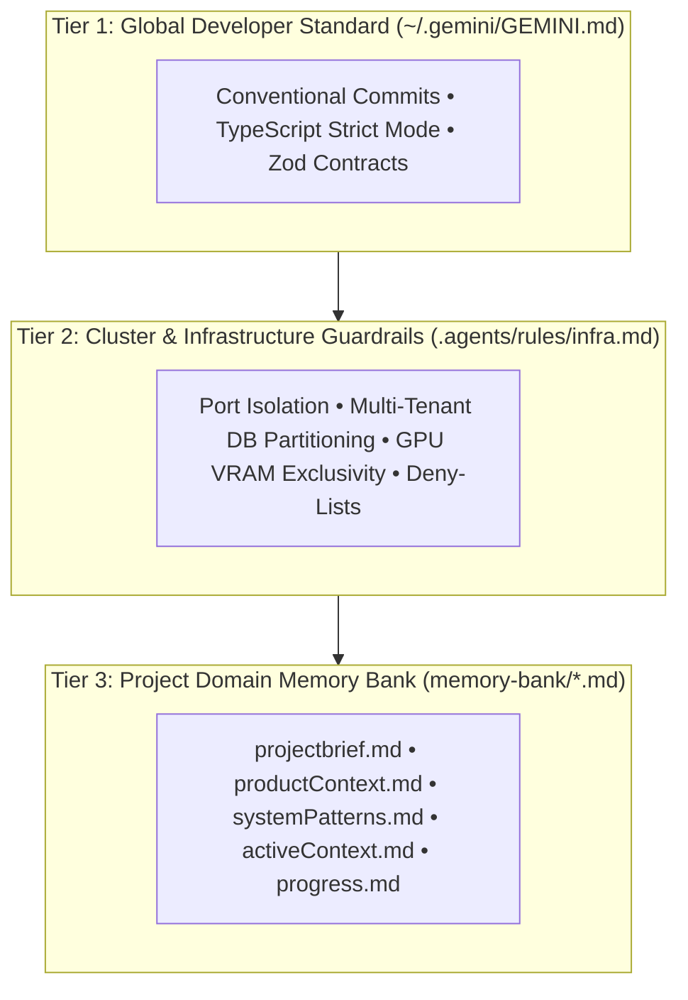
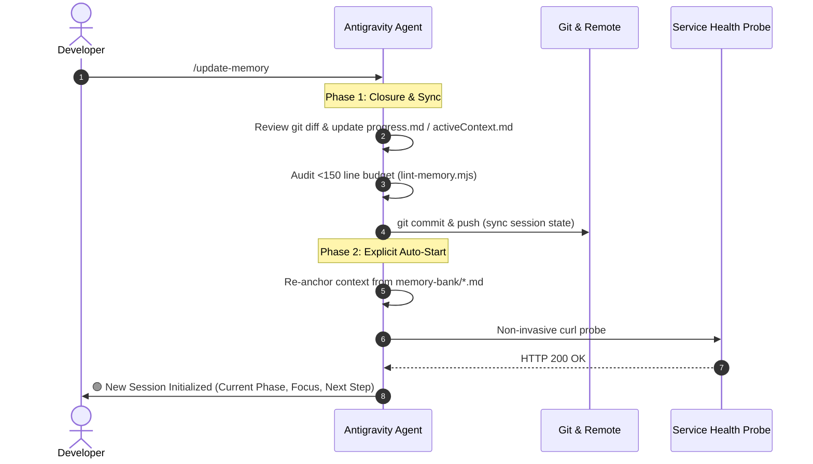

# Antigravity Memory Bank 🧠

[](LICENSE)
[](https://github.com/johnny-saigon/antigravity-memory-bank/actions)

A production-tested **Three-Tier Memory Bank** brick and **Antigravity Plugin** for autonomous, context-aware AI pair programming.

Eliminates context drift, prevents cross-database contamination, enforces token limits (< 150 lines per document), and enables continuous session cycling without manual restarts.

---

## 🏛️ The Three-Tier Memory Architecture



---

## ⚡ 3. How to Use the Installer

### A. On-the-Fly Installation in Existing Projects (Active Antigravity Window)

If you are already working inside an active Antigravity session on an existing project (e.g. **`BinaryDay`**, **`RemoveBackGround`**, or any local repository connected to GitHub), you can activate the Memory Bank instantly with **zero IDE restart**:

```bash
# Automated on-the-fly execution (auto-detects project stack, git remotes, and ports):
npx github:johnny-saigon/antigravity-memory-bank init -y --commit

# Or via universal one-line shell installer:
curl -fsSL https://raw.githubusercontent.com/johnny-saigon/antigravity-memory-bank/main/install.sh | bash -s -- -y --commit
```

#### Why It Works on the Fly:
Antigravity dynamically ingests workspace rules (`AGENTS.md`, `.agents/rules/`) and workspace skills (`.agents/skills/start`, `.agents/skills/update-memory`) as soon as they appear in the project root.
- **Immediate in-chat activation**: Run the command in your terminal or prompt the agent to execute it, and you can invoke `/start` immediately in the same conversation!
- **Non-destructive**: Preserves any existing custom `AGENTS.md` guidelines while injecting the Memory Bank links and rules.
- **Git synchronization**: When `--commit` is passed, automatically stages and commits the memory baseline to Git, ready to `git push origin main` to GitHub.

---

### B. Interactive Scaffolding for New or Custom Projects

Inside your target repository root, run the CLI interactively:

```bash
npx github:johnny-saigon/antigravity-memory-bank init
```

The CLI inspects `package.json`, `.git/config`, and environment files, presenting auto-detected values in brackets as defaults—simply press `ENTER` to accept:
- **Project Name & Tagline**: Auto-extracted from `package.json` or git remote.
- **Target Platforms**: Web, iOS, Android, CLI, Monorepo (auto-detects Expo, Next.js, etc.).
- **Tech Stack**: Frontend, Backend, Database, Cache (auto-detects Fastify, React, Prisma, pg, etc.).
- **Allocated Port & Health URL**: Internal port allocation and health probe endpoint for automated verification.

It automatically scaffolds:
- `memory-bank/*.md` (6 specialized context documents, all strictly `< 150 lines`)
- `AGENTS.md` (Top-level agent directives and context bootstrap links)
- `.agents/rules/` (Tier 2 infrastructure & negative constraint deny-lists)
- `.agents/skills/` (`/start` and `/update-memory` continuous lifecycle skills)
- `scripts/lint-memory.mjs` (Automated line-budget enforcer, added to `package.json` as `npm run lint:memory`)

#### 🔍 Automated Historical Context Scraping:
During new project initialization (`init`), the installer **scrapes all prior build history, documentation, and Antigravity conversation transcripts** to construct an accurate baseline:
1. **Antigravity Conversation Transcripts (`~/.gemini/antigravity/brain/`)**: Scans past agent transcripts for the project, extracting recent accomplishments, technical decisions, and pending backlog tasks.
2. **Project Documentation**: Ingests `docs/**/*.md` (including `BUG_FIX_RECORDS.md`), `README.md`, `MIGRATION_BOARD.md`, and `DESIGN.md`.
3. **Git Commit History**: Parses the commit log (`feat:`, `fix:`, releases) to populate completed milestones (`[x]`) and resolved bugs.

This ensures that the initialized Memory Bank is **never an empty placeholder**, but rather a rich, fully populated reflection of your codebase's real state from day one.

---

### C. Installing as an Antigravity Plugin

Clone directly into the project's `.agents/plugins/` directory:

```bash
mkdir -p .agents/plugins
git clone https://github.com/johnny-saigon/antigravity-memory-bank.git .agents/plugins/memory-bank
```

Or install globally across all projects on your machine:

```bash
mkdir -p ~/.gemini/config/plugins
git clone https://github.com/johnny-saigon/antigravity-memory-bank.git ~/.gemini/config/plugins/memory-bank
```

Antigravity automatically loads the bundled plugin assets:
- **Manifest**: `plugin.json` (declares `/start`, `/update-memory`, and budget audits)
- **Bundled Skills**: `skills/start/SKILL.md` and `skills/update-memory/SKILL.md`
- **Bundled Directives**: `rules/AGENTS.md` (Three-Tier Memory Hierarchy rules)

> [!TIP]
> For active workspaces in ongoing pair-programming sessions, **Option A (Workspace Brick)** is recommended because its skills and rules activate **immediately on the fly** without restarting the IDE. **Option C (Plugin)** is ideal for machine-wide standardization across restarts.

---

### D. Upgrading Earlier Implementations (BinaryDay, RemoveBackGround, SnapCal)

If a project already has an earlier implementation of the Memory Bank (without the 2-phase lifecycle, linter, export, or deinstall tools), run the **in-place, non-destructive upgrade**:

```bash
# Inside BinaryDay, RemoveBackGround, or SnapCal root:
npx github:johnny-saigon/antigravity-memory-bank upgrade --commit

# Or via universal one-liner:
curl -fsSL https://raw.githubusercontent.com/johnny-saigon/antigravity-memory-bank/main/install.sh | bash -s -- upgrade --commit
```

#### What the Upgrade Does:
1. **100% Domain Context Preservation**: All existing markdown documents in `memory-bank/` (`projectbrief.md`, `systemPatterns.md`, `psychometrics.md`, etc.) and Tier 2 cluster invariants (`.agents/rules/infra.md`) remain untouched.
2. **Upgrades to Continuous 2-Phase Cycle**: Auto-detects the project's title and live health probe (e.g. `https://binaryday.app/api/health` or `http://85.10.218.46:44190/api/health`), upgrading `.agents/skills/update-memory/SKILL.md` so `/update-memory` automatically starts the next session cycle.
3. **Upgrades `AGENTS.md`**: Updates operational mandate #4 to reference continuous cycling.
4. **Installs the Line-Budget Linter**: Adds `scripts/lint-memory.mjs` and verifies that all existing documents comply with the `< 150 lines` rule.
5. **Adds Lifecycle Scripts to `package.json`**:
   - `npm run lint:memory`: Audits token line counts.
   - `npm run memory:export`: Exports context to markdown & tarball anytime.
   - `npm run memory:uninstall`: Safely uninstalls the brick if ever desired.
6. **Git Synchronization**: When `--commit` is passed, commits the upgrade cleanly into version control.

---

## 📦 4. Context Export & Clean Deinstallation

### A. Exporting Project Memory & Context
You can export the entire project memory bank at any time into a human-readable consolidated snapshot and a compressed raw backup archive:

```bash
# Standalone export command:
npx github:johnny-saigon/antigravity-memory-bank export

# Or via universal one-liner:
curl -fsSL https://raw.githubusercontent.com/johnny-saigon/antigravity-memory-bank/main/install.sh | bash -s -- export
```

Outputs generated in `./memory-backups/`:
1. **Consolidated Markdown** (`memory-bank-export-YYYYMMDD-HHmmss.md`): Single consolidated document containing a table of contents, timestamps, and full text of all memory-bank files, rules, and skills. Ideal for sharing with external models, code review, or pasting into team wikis.
2. **Compressed Archive** (`memory-bank-backup-YYYYMMDD-HHmmss.tar.gz`): Bit-for-bit compressed tarball of `memory-bank/`, `AGENTS.md`, and `.agents/` for instant restoration anytime.

---

### B. Clean Deinstallation (Zero Context Loss)

To completely remove the Memory Bank from a project while **guaranteeing that all project memory is preserved**:

```bash
# Interactive deinstallation (prompts for confirmation):
npx github:johnny-saigon/antigravity-memory-bank uninstall

# Automated on-the-fly deinstallation with Git commit:
npx github:johnny-saigon/antigravity-memory-bank uninstall -y --commit
```

#### What the Deinstallation Workflow Does:
1. **Automated Safety Export**: Automatically performs a full context export (`.md` and `.tar.gz`) into `./memory-backups/` *before* deleting any files (unless explicitly bypassed with `--no-export`).
2. **Targeted Artifact Cleanup**:
   - Deletes `memory-bank/`.
   - Deletes `.agents/skills/start/` and `.agents/skills/update-memory/` (leaves unrelated custom skills intact).
   - Deletes `.agents/rules/infra.md` and `.agents/rules/negative-constraints.md` (leaves other rules intact).
   - Deletes `scripts/lint-memory.mjs`.
   - Cleans `"lint:memory"` from `package.json` scripts.
   - Cleans or removes `AGENTS.md` (preserves any custom project instructions).
   - Cleans `.agents/plugins/memory-bank` if installed in plugin mode.
3. **Git Commit**: When `--commit` is passed, records the deinstallation into Git:
   `chore(memory): cleanly deinstall Antigravity Memory Bank (context archived)`.

---

## 🔄 The Continuous Session Lifecycle

Unlike legacy memory systems that require stopping and manually restarting, this brick uses a **2-Phase Continuous Loop**:



### The Two-Phase Lifecycle Breakdown
Whenever `/update-memory` is triggered (or when a major milestone completes):

#### Phase 1: Milestone Closure & Git Synchronization
1. **Git Diff & Status Review**: Inspects working tree changes (`git status -s` and `git diff --stat`) to verify what was modified.
2. **Context & Progress Updates**: Marks finished acceptance criteria in `memory-bank/progress.md` (`[x]`) and records architectural decisions, schema migrations, and resolved bugs in `memory-bank/activeContext.md`.
3. **Token Line Budget Audit**: Automatically verifies that every file in `memory-bank/*.md` remains strictly **`< 150 lines`** (via `scripts/lint-memory.mjs`). If a domain expands, it splits into a linked sub-file (`@[Topic](path.md)`).
4. **Infrastructure Invariant Verification**: Checks that no Tier 2 cluster invariants (`.agents/rules/infra.md`), port allocations, or database boundaries were violated.
5. **Git Commit & Push**: Stages and commits memory updates with Conventional Commits (e.g. `docs(memory-bank): sync session state and close milestone`) and pushes to the remote branch.

#### Phase 2: Explicit Auto-Start & Cycle Bootstrap
6. **Context Re-Anchoring**: Re-reads `memory-bank/activeContext.md` and `memory-bank/progress.md` to identify the next priority tasks.
7. **Cleanliness & Head Check**: Confirms working tree cleanliness (`git status -s`) and head commit (`git log -n 1 --oneline`).
8. **Live Service Health Probing**: Executes a non-invasive health check against the target API/service (e.g. `curl -s http://<host>:<port>/health`).
9. **Active Session Status Banner**: Immediately outputs the fresh 3-bullet status summary without requiring the developer to manually type `/start`:
   - 🟢 **New Session Cycle Initialized**
   - **Current Phase**: [Current project phase from activeContext.md]
   - **Immediate Focus**: [Top pending task / feature / bug in progress]
   - **Proposed Next Action**: [Concrete first step ready for execution]

---

## 📏 Token Efficiency & The 150-Line Budget

Large context dumps degrade LLM reasoning and balloon context consumption. Every document in `memory-bank/` must stay **under 150 lines**.

Run the built-in linter anytime:
```bash
npm run lint:memory
```

When a topic expands, split it into a linked sub-file:
```markdown
@[Vision Taxonomy](memory-bank/visionTaxonomy.md)
```

---

## 🛠️ Repository Scripts

| Script | Command | Description |
| :--- | :--- | :--- |
| **Lint Memory** | `npm run lint:memory` | Verifies all memory files adhere to the 150-line rule |
| **Test** | `npm test` | Runs validation on templates and manifests |
| **CLI Init** | `node bin/cli.mjs init` | Interactive project setup wizard |

---

## 📄 License
MIT © [johnny-saigon](https://github.com/johnny-saigon)
