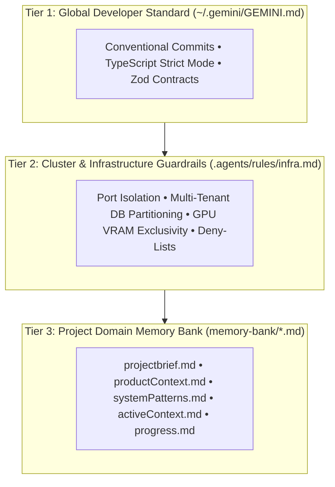
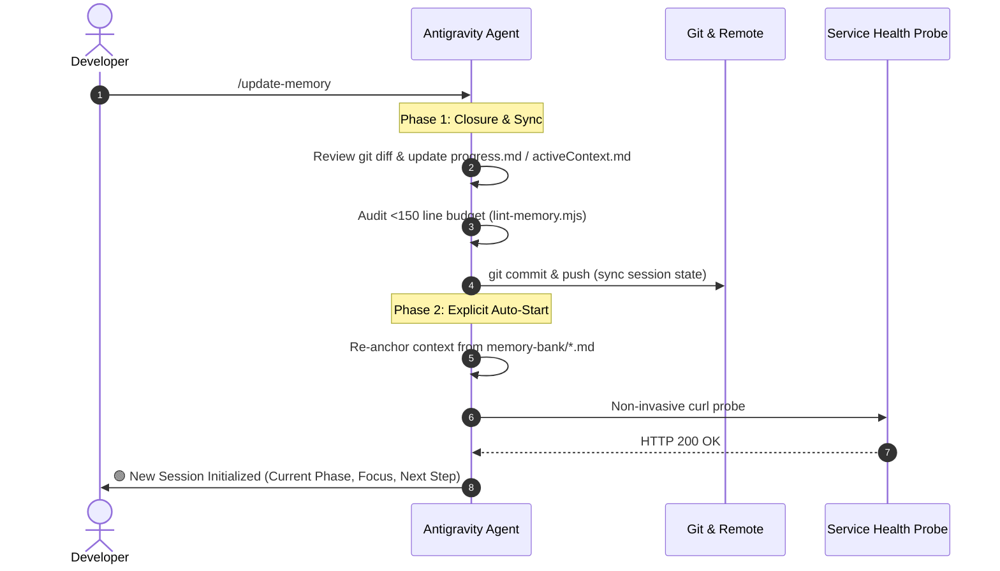

# Antigravity Memory Bank 🧠

[](LICENSE)
[](https://github.com/johnny-saigon/antigravity-memory-bank/actions)

A production-tested **Three-Tier Memory Bank** brick and **Antigravity Plugin** for autonomous, context-aware AI pair programming.

Eliminates context drift, prevents cross-database contamination, enforces token limits (< 150 lines per document), and enables continuous session cycling without manual restarts.

---

## 🏛️ The Three-Tier Memory Architecture



---

## ⚡ Quick Start

### Option 1: Scaffold into any Project via `npx`
Run the interactive initializer inside your target project root:

```bash
npx https://github.com/johnny-saigon/antigravity-memory-bank init
```

Or with standard npm:
```bash
npx antigravity-memory-bank init
```

This automatically scaffolds:
- `memory-bank/*.md` (8 specialized context files)
- `AGENTS.md` (Top-level agent directives)
- `.agents/rules/` (Tier 2 cluster & negative constraints)
- `.agents/skills/` (`/start` and `/update-memory`)
- `scripts/lint-memory.mjs` (Automated line-budget enforcer)

---

### Option 2: Install as an Antigravity Plugin

Clone or install directly into your workspace's `.agents/plugins/` or global `~/.gemini/config/plugins/`:

```bash
mkdir -p .agents/plugins
git clone https://github.com/johnny-saigon/antigravity-memory-bank.git .agents/plugins/memory-bank
```

Antigravity will automatically detect the plugin manifest:
- **Manifest**: `plugin.json`
- **Bundled Skills**: `/start`, `/update-memory`
- **Bundled Directives**: `rules/AGENTS.md`

---

## 🔄 The Continuous Session Lifecycle

Unlike legacy memory systems that require stopping and manually restarting, this brick uses a **2-Phase Continuous Loop**:



---

## 📏 Token Efficiency & The 150-Line Budget

Large context dumps degrade LLM reasoning and balloon context consumption. Every document in `memory-bank/` must stay **under 150 lines**.

Run the built-in linter anytime:
```bash
npm run lint:memory
```

When a topic expands, split it into a linked sub-file:
```markdown
@[Vision Taxonomy](memory-bank/visionTaxonomy.md)
```

---

## 🛠️ Repository Scripts

| Script | Command | Description |
| :--- | :--- | :--- |
| **Lint Memory** | `npm run lint:memory` | Verifies all memory files adhere to the 150-line rule |
| **Test** | `npm test` | Runs validation on templates and manifests |
| **CLI Init** | `node bin/cli.mjs init` | Interactive project setup wizard |

---

## 📄 License
MIT © [johnny-saigon](https://github.com/johnny-saigon)
