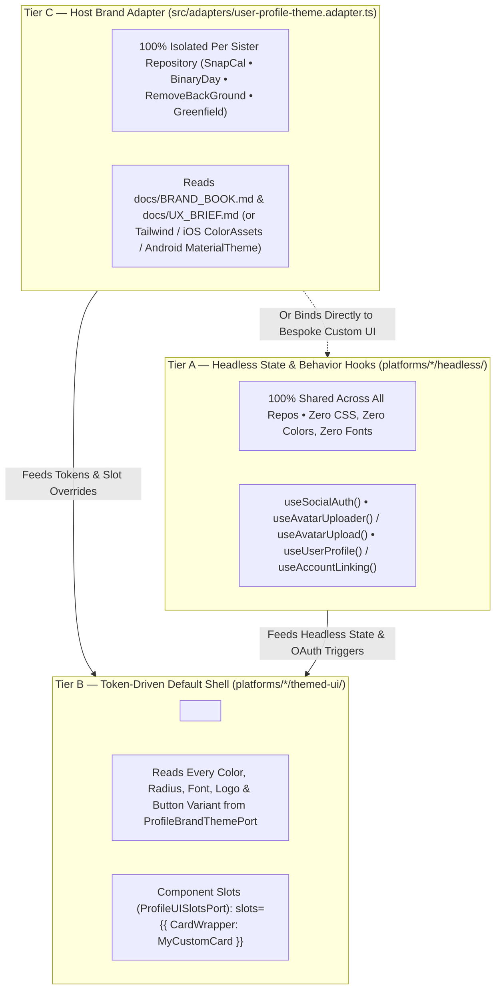

# 🧱 Hexagonal Brick & Pluggable UX/UI Branding Architecture Guide

Every project initialized (`init`) or upgraded (`upgrade`) with `antigravity-memory-bank` supports **Shared Hexagonal Bricks** (`bricks/<name>/`, such as `bricks/user-profile`) with a **3-Tier Pluggable UX/UI & Branding Architecture** across **Web, iOS, and Android**.

This architecture allows multiple applications (`SnapCal`, `BinaryDay`, `RemoveBackGround`, or any greenfield project) to share **100% of core security, OAuth 2.0 / OIDC verification (Google, Facebook, Apple, Microsoft), GDPR compliance, and state management**, while keeping **100% of visual branding, colors, typography, and custom layout slots isolated per repository**.

---

## 🎨 1. How the Pluggable UX/UI & Branding Architecture Works

We split every brick's presentation layer into **3 decoupled tiers** across Web (`React` / `Next.js`), iOS (`SwiftUI`), and Android (`Jetpack Compose`):



### Tier A — Headless State & Behavior Hooks (`platforms/*/headless/`)
- **100% shared across all repositories.**
- Handles form validation, loading/error states, OAuth redirect/popup triggers (`useSocialAuth()`), optimistic avatar cropping/upload (`useAvatarUploader()` / `useAvatarUpload()`), and account-linking confirmation modals (`useUserProfile()` / `useAccountLinking()` / `useProfileSettings()`).
- **Zero CSS, zero colors, zero fonts.**
- On iOS and Android, equivalent headless coordinators (`NativeSocialOAuthCoordinator.swift`, `UserProfileViewModel.swift`, `CredentialManagerOAuthBridge.kt`) manage native `ASWebAuthenticationSession` / `ASAuthorizationAppleIDProvider` and Android `CredentialManager` flows with zero hardcoded styling.

### Tier B — Token-Driven Default Shell (`platforms/*/themed-ui/`)
- Shared layout primitives (`SocialLoginButtonGroup`, `AvatarCropUploadModal`, `UserProfileSettingsView`) that consume `<ProfileThemeProvider slots={customSlots} theme={hostTheme}>` (and `ProfileThemeConfiguration.swift` on iOS / `ProfileThemeTokens.kt` on Android).
- Every color, border radius, typography scale, spacing unit, app logo, and social button variant (`pill`, `outline`, `icon-only`, `dark`/`light`) is read from a strict **`ProfileBrandThemePort`** contract and injected as `--ag-profile-*` CSS custom properties (or native SwiftUI/Compose tokens).
- **Supports Component Slots (`ProfileUISlotsPort` — Slot Overrides)**:
  If an application (e.g., `RemoveBackGround`) wants a completely custom glassmorphic Card wrapper or custom header while keeping the brick's form internals and 4-provider OAuth buttons, it simply passes:
  ```tsx
  <ProfileThemeProvider
    theme={hostTheme}
    slots={{ CardWrapper: MyCustomGlassCard, HeaderBanner: MyCustomHeader }}
  >
    <UserProfileSettingsView ... />
  </ProfileThemeProvider>
  ```
  **Zero lines of the brick's source code are touched.**

### Tier C — Host Brand Adapter (`src/adapters/user-profile-theme.adapter.ts`)
- **100% isolated per sister repository.**
- Lives in the consumer repository (`src/adapters/user-profile-theme.adapter.ts` in `SnapCal`, `BinaryDay`, `RemoveBackGround`, or any new installation).
- Reads that specific project's `docs/BRAND_BOOK.md` and `docs/UX_BRIEF.md` (or Tailwind/CSS variables, iOS `ColorAssets`, or Android `MaterialTheme`) and feeds them into the brick.
- Protected during upgrades: running `npx antigravity-memory-bank brick upgrade user-profile` updates `bricks/user-profile/core/` and `bricks/user-profile/platforms/` while **never overwriting** `src/adapters/user-profile-theme.adapter.ts`.

---

## 🚀 2. Bonus: How to Plug in a Brand New UX/UI Redesign Later (in Any Repo)

Because `src/adapters/user-profile-theme.adapter.ts` and the `headless/` hooks are **100% isolated** from the brick's core logic, whenever you design a new UI mockup (e.g., from Figma or Stitch) for `BinaryDay`, `SnapCal`, `RemoveBackGround`, or any project in the future:

1. **Attach the UX/UI `.zip` bundle or screenshot offline at `0` token cost**:
   ```bash
   npm run backlog add "Apply New Brand UX/UI to User Profile" --type feature --priority medium
   npm run backlog attach FEAT-105 ./path/to/new-profile-ui.zip
   ```
2. **Plan and execute with `/backlog-plan` and `/backlog-start`**:
   ```text
   /backlog-plan FEAT-105
   ```
   After reviewing `implementation_plan.md`, click **Proceed** or run `/backlog-start FEAT-105`.
   The agent updates **only** `src/adapters/user-profile-theme.adapter.ts` (or drops custom slot components into `slots={{ ... }}`), leaving **100% of your 4 OAuth logins, security logic, and database adapters untouched!**

---

## 🛠️ 3. Installing & Upgrading Bricks Across New or Existing Projects

```bash
# 1. List available shared bricks in the catalog:
npx github:johnny-saigon/antigravity-memory-bank brick list

# 2. Install for Web + iOS + Android (e.g., SnapCal, BinaryDay):
npx github:johnny-saigon/antigravity-memory-bank brick install user-profile --platforms web,ios,android

# 3. Install for Web-only (e.g., RemoveBackGround — skips iOS/Android directories):
npx github:johnny-saigon/antigravity-memory-bank brick install user-profile --platforms web

# 4. Install on a brand-new greenfield app WITH canonical SQL + Prisma schemas:
npx github:johnny-saigon/antigravity-memory-bank brick install user-profile --platforms web,ios,android --with-schema

# 5. Non-destructively upgrade core OAuth & platform modules (preserves src/adapters/*):
npx github:johnny-saigon/antigravity-memory-bank brick upgrade user-profile

# 6. Verify brick health & structural invariants:
npx github:johnny-saigon/antigravity-memory-bank brick doctor user-profile
```
