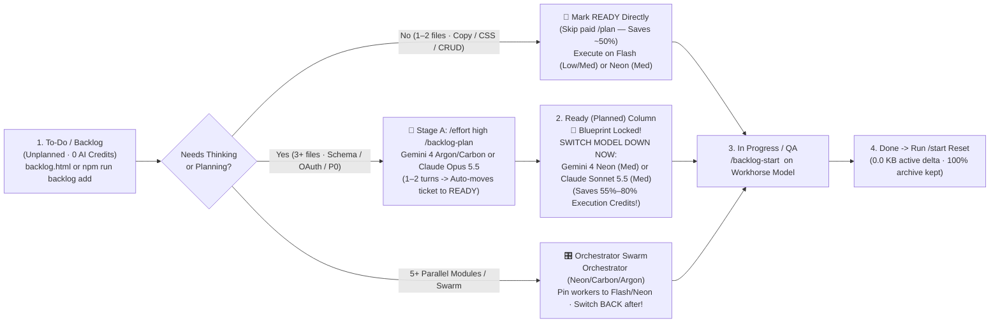

# 💰 Antigravity Credits CheatSheet — AGY 3-Family Model & Quality-to-Credit ROI Guide

> **Mission (Job-To-Be-Done):** Save Antigravity credits while maximizing your **Quality-to-Used-Credits Ratio (`Q/C ROI`)** on every ticket — synchronized with all **27 deployed AGY model/effort variants** across **Google Gemini**, **External Partner Models**, and **Google Orchestrators**.
>
> **Living Maintenance Rule:** Whenever Antigravity (AGY) deploys, renames, or retires models, update this **Credits CheatSheet** (`docs/CREDITS_CHEATSHEET.md` & `templates/docs/CREDITS_CHEATSHEET.md`), `scripts/lint-memory.mjs`, and `scripts/backlog.mjs`, then run `upgrade` to sync every installed Memory Bank project automatically.

---

## 🧭 1. 4-Column Kanban Credit-Saving Flowchart (`To-Do` → `Ready` → `In Progress` → `Done`)

---

## ⚖️ 2. Full AGY 3-Family Model Reference & Dual Quota-Pool Balancing

> [!TIP]
> **Dual Quota-Pool Secret (Two Independent 4-Hour Reset Clocks):**
> - **Quota Pool 1 (Google):** All **Google Gemini** models + all **Google Orchestrators** share one quota clock.
> - **Quota Pool 2 (External):** **Claude Sonnet 5.5**, **Claude Opus 5.5**, and **GPT-OSS 120B** share a *separate* quota clock.
> - **Pro Move:** If Pool 1 drops below `30%`, shift daily work to **Claude Sonnet 5.5 (Med)** or **GPT-OSS 120B (Med)** instead of hitting a wall or enabling paid overage!

### 🔵 Family 1 — Google Gemini Models *(Quota Pool 1: Google)*

| Model & Effort Variants | Credit Burn | Sweet Spot & Best Tickets | Avoid Using For |
| :--- | :---: | :--- | :--- |
| **Gemini 3.8 Flash** *(Low / Medium / High)* | **`1.0x`** *(Baseline)* | Boilerplate UI, CSS, copy tweaks, docs formatting, unit test runs, and browser/research subagents | Complex multi-file architecture or P0 concurrency bugs |
| **Gemini 4 Hydrogen** *(Low / Medium / High / **XHigh**)* | **`1.3x–2.0x`** *(Agile)* | Agile Gemini 4 coding; **`XHigh`** gives deep reasoning bursts on single-module algorithms without full Argon cost | Large cross-repo migrations |
| **Gemini 4 Neon** *(Low / Medium / High / **XHigh**)* | **`2.0x–3.0x`** *(Best Daily ROI)* | **Premier daily-driver sweet spot for 80% of feature & bug tickets** and executing approved `/backlog-plan` sub-tickets | Trivial 1-line copy tweaks (use Flash) |
| **Gemini 4 Carbon** *(Low / Medium / High)* | **`3.5x–4.5x`** *(Deep Systems)* | Deep multi-file systems engineering, backend/DB adapters, OAuth flows, and complex state machines | Routine CSS/docs formatting |
| **Gemini 4 Argon** *(Low / Medium / High)* | **`5.0x–7.0x`** *(Frontier Architect)* | Heavyweight frontier architect — **reserve for 1–2 turn `/backlog-plan`**, cross-repo contracts, and P0 root-cause diagnosis | Leaving active for 10+ implementation/test-fix turns |

---

### 🟠 Family 2 — External Partner Models *(Quota Pool 2: Independent Reset Clock)*

| Model & Effort Variants | Credit Burn | Sweet Spot & Best Tickets | Avoid Using For |
| :--- | :---: | :--- | :--- |
| **GPT-OSS 120B** *(Medium)* | **`1.5x`** *(Open-Weight Offload)* | High-efficiency external offload for routine coding, scaffolding, boilerplate, or second-opinion reviews while preserving Google & Claude quota | Deep multi-file UI/UX design surgery |
| **Claude Sonnet 5.5** *(Low / Medium / High)* | **`2.5x–4.0x`** *(Surgical Code)* | Surgical TypeScript/React/UI component implementation and multi-file refactoring *(External Pool twin of Gemini 4 Neon / Carbon)* | Running bulk repetitive lint/docs commands |
| **Claude Opus 5.5** *(Low / Medium / High)* | **`6.0x–9.0x`** *(Heavyweight Frontier)* | Strictly for **1-turn `/backlog-plan` blueprints**, security audits, or stubborn P0 bugs | **Never** leave active for routine iterative test-fix loops! |

---

### 🟣 Family 3 — Google Orchestrators *(Quota Pool 1: Multi-Agent / Swarm Coordinators)*

| Orchestrator Variant | Model ID | Credit Multiplier | Best Use Case |
| :--- | :--- | :---: | :--- |
| **Orchestrator (Neon)** | `gemini-pro-orchestrator-neon` | **`3.0x–4.5x`** | Coordinator for lightweight `2–3` worker parallel tasks (`swarm` / `/teamwork`) |
| **Orchestrator (Carbon)** | `gemini-pro-orchestrator` | **`4.5x–6.5x`** | Coordinator for multi-module feature pipelines and cross-layer refactors |
| **Orchestrator (Argon)** | `gemini-pro-orchestrator-argon` | **`6.5x–10.0x`** | Frontier coordinator for large-scale repository migrations or multi-agent architectural audits |

> [!WARNING]
> **Explicit Orchestrator Credit Warning (`3x–6x` Fan-Out Multiplier):**
> Orchestrators spawn and coordinate multiple turns and subagent workers automatically. **NEVER leave an Orchestrator selected for single-agent ticket execution (1–3 file tasks)** — always switch back to **Gemini 4 Neon** or **Gemini 3.8 Flash** as soon as your swarm finishes!

---

## 🔀 3. Backlog-First & Two-Stage Split Routing (Save `55%–80%` Credits)

1. **Always Create a Backlog Ticket Offline First (`0 AI Tokens`)**:
   - Use the Review pane (`backlog.html` → **➕ Quick Capture Task**) or CLI (`npm run backlog add "<Title>" --components "<files>"`).
   - Pre-defining target files and `.zip`/spec attachments offline eliminates `2–4` exploratory chat turns (**`~15k–30k` tokens saved immediately**).
2. **Use the `Ready (Planned)` Column to Trigger Your Model Downgrade (`55%–80%` Credit Savings)**:
   - **Column 1 (`To-Do / Backlog` — Unplanned)**: Holds raw ideas and tickets that still need architectural thinking. For `1–2` file low-ambiguity tasks, skip a paid `/plan` turn and click `📐` (`npm run backlog ready <ID>`) or start directly on `Gemini 3.8 Flash` / `Gemini 4 Neon`.
   - **Column 2 (`Ready (Planned)` — Blueprint Locked)**: Running `/backlog-plan <ID>`, `npm run backlog plan <ID>`, or `npm run backlog split` automatically promotes planned tickets here. Whenever you pick up a ticket from **`Ready (Planned)`**, **Stage A planning is already paid for** — immediately **switch your AGY model picker DOWN** (from Argon/Opus to **Gemini 4 Neon (Medium)** or **Claude Sonnet 5.5 (Medium)**) before running `/backlog-start <ID>`!

---

## 🧠 4. `/effort` Slash Command vs. Model Thinking Effort (Two Different Knobs)

Antigravity gives you **two independent effort controls**. Understanding how they differ — and pairing them intentionally — is one of the fastest ways to eliminate wasted credits without sacrificing engineering quality.

1. **Model Thinking Effort *(Inference-Level Parameter — AGY Model Picker: `(Low)` / `(Medium)` / `(High)` / `(XHigh)`)*:**
   - **What it controls:** The neural network's **internal reasoning token budget** (the private chain-of-thought scratchpad computed *before* emitting the first visible token — e.g., Gemini thinking budget, Claude `thinking.budget_tokens`, OpenAI `reasoning_effort`).
   - **Behavior:** `Low` caps internal reasoning tokens for fast, low-cost turns; `High` / `XHigh` unlocks deep multi-step simulation, constraint checking, and internal self-correction at higher latency and per-turn token cost.
   - **Scope:** Applies to each **individual model call**.

2. **Antigravity `/effort [low|medium|high|xhigh]` *(Agent Workflow & Governance Control — `.agents/skills/effort/SKILL.md` & `scripts/lint-memory.mjs --effort`)*:**
   - **What it controls:** **Agent behavior across the full ticket lifecycle** — hard tool-turn budgets (`≤ 4` / `≤ 6` / `≤ 8` turns), whether a separate `/backlog-plan` gate is required before editing files, diagnostic/exploration rigor, and model-routing prescriptions across Google, External, and Orchestrator pools.
   - **Important:** Typing `/effort low` or `/effort high` does **not** automatically change the AGY model dropdown — it governs how the agent plans, explores, batches tools, and advises you to shift your model picker.

| Dimension | Model Thinking Effort *(Inference Knob)* | Antigravity `/effort` *(Agent Skill & Workflow Rule)* |
| :--- | :--- | :--- |
| **Layer** | LLM provider decoding / reasoning loop | Workspace orchestration & prompt governance |
| **Primary Metric** | Internal chain-of-thought token budget | Tool turns, file-read breadth, planning gates & verification depth |
| **Scope** | Single generation turn | End-to-end ticket lifecycle across multiple tool turns |
| **Configured Via** | AGY Model Picker dropdown *(e.g., `Gemini 4 Neon (Medium)`)* | Chat slash command (`/effort low \| medium \| high \| xhigh`) |
| **Credit Impact** | Scales token consumption per model call | Prevents credit bleed by capping diagnostic loops & enforcing model matching |

### 🎯 Recommended Knob Pairings (Model Picker + `/effort`)

| Ticket Profile | AGY Model Picker *(Thinking Effort)* | Workspace Command | Why This Pairing Wins |
| :--- | :--- | :--- | :--- |
| **Micro-tasks, CSS, copy, docs, unit tests** | `Gemini 3.8 Flash (Low/Med)` · `GPT-OSS 120B (Med)` | `/effort low` | Skips paid `/plan` (`≤ 4` turns) and keeps per-turn reasoning cost at baseline `1.0x–1.5x` |
| **Standard features & single-component bugs** | `Gemini 4 Neon (Medium)` · `Claude Sonnet 5.5 (Medium)` | `/effort medium` | Best daily `Q/C ROI` (`≤ 6` turns); balanced internal reasoning without frontier overhead |
| **Stage A: Multi-file / Schema / OAuth / P0 Plan** | `Gemini 4 Argon (High)` · `Carbon (High)` · `Claude Opus 5.5 (Med/High)` | `/effort high /backlog-plan <ID>` | Concentrates frontier thinking tokens into `1–2` planning turns to lock `implementation_plan.md` |
| **Stage B: Execute Approved Plan** | **Switch DOWN** → `Gemini 4 Neon (Med/High)` · `Claude Sonnet 5.5 (Med)` | `/effort medium /backlog-start <ID>` | Plan is already paid for; cuts execution credit burn by **`55%–80%`** |
| **Deep single-module algorithm / state math** | `Gemini 4 Neon (XHigh)` · `Gemini 4 Hydrogen (XHigh)` | `/effort xhigh` | Maximum per-turn reasoning depth on one focused module without full Argon/Opus rates |
| **Parallel multi-subsystem swarms (`5+` modules)** | `Orchestrator (Neon/Carbon/Argon)` *(workers on Flash/Neon)* | `/effort xhigh` | High-leverage fan-out only when modules are independent — **switch model picker down immediately after** |

---

## 🏆 5. Credit & Quality Best Practices (The 10 Golden Rules)

1. **Align Both Knobs — Never Over-Pay or Under-Power**: Never leave `Argon (High)` or `Opus (High)` selected for CSS/docs/boilerplate, and never force `Flash (Low)` to architect a multi-file OAuth/DB migration (failed retry loops burn more credits than planning once cleanly).
2. **Always Separate Planning Credits from Execution Credits (Two-Stage Split)**: For any `3+` file feature, schema migration, or P0 bug, run `/effort high /backlog-plan <ID>` on a frontier model for `1–2` turns, approve the blueprint, then **immediately switch the model picker down** to `Gemini 4 Neon (Medium)` or `Claude Sonnet 5.5 (Medium)` for `/backlog-start` (`55%–80%` savings).
3. **Capture Tickets & Context Offline First (`0` AI Tokens)**: Log scope, target files (`--components`), and spec/mockup attachments in `backlog.html` or `npm run backlog add` *before* starting chat — eliminates `2–4` exploratory discovery turns (`~15k–30k` tokens saved upfront).
4. **Reset Context Immediately After Every Ticket (`/start`)**: Run `/start` (auto-runs `/clear` & `/compact` pre-flight) the moment a ticket closes so `50k+` token build/test logs are never re-billed on every turn of your next task (`~95%` per-turn cost reduction).
5. **Batch Tool Calls & Honor the Hard Turn Budget (`≤ 4/6/8` Turns)**: Every extra agent turn re-sends the entire conversation history. Batch independent file reads into `1` turn, edits into `1–2` turns, and verification/deploy commands into `1–2` chained shell calls (`&&`).
6. **Work Memory-First — Never Re-Discover Recorded State**: Check `memory-bank/activeContext.md` and `docs/backlog.json` before grepping or running diagnostics; never scrape `.system_generated/logs/transcript*.jsonl` or unrelated sibling repositories.
7. **Balance Dual Quota Pools Proactively**: Google Gemini + Orchestrators (**Pool 1**) and Claude + GPT-OSS (**Pool 2**) run on independent 4-hour reset clocks. Shift routine coding to `Claude Sonnet 5.5 (Med)` or `GPT-OSS 120B (Med)` whenever Pool 1 drops below `30%`.
8. **Switch Off Orchestrators Immediately After Swarms**: Google Orchestrators apply a `3x–6x` fan-out multiplier. Reserve them for `3–5+` independent parallel modules and switch your model picker back to `Neon` or `Flash` as soon as the swarm wraps up.
9. **Keep Progressive Disclosure Lean (`/context`)**: Keep root `AGENTS.md` `< 50` lines (no `@[...]` inline expansion), `memory-bank/*.md` `< 150` lines, and `.agents/rules/*.md` on `trigger: model_decision` so idle rules never inflate your baseline token tax.
10. **Keep Overage `OFF` & Audit Regularly**: Leave Google One / Antigravity **"Toggle for overage"** disabled for a hard stop at your `20x` baseline limit, and run `npm run backlog advise [ID]`, `/credits`, or `/usage` whenever sessions feel slow or heavy.

---

## ⚡ 6. The 5 Kanban State-Machine Workflows & Quick-Reference Controls

| # | Workflow / Trigger | Model Selection Gate | Target Column | What Happens |
| :---: | :--- | :--- | :---: | :--- |
| **1** | **`/backlog-add <idea>`** *(or Quick Capture in `backlog.html`)* | None (`0` plan/code credits) | **`TO DO`** | Auto-annotates `components`, `acceptanceCriteria` & Credit-ROI tier (`🏷️ Annotated`) in `TO DO` and **stops in `≤ 2` turns**. |
| **2** | **`/backlog-plan <new idea or ID>`** *(Direct-to-`READY` from prompt)* | `ask_question` picker (or `--model`) selects **Planning Model** | **`READY`** | Creates/loads ticket, plans `implementation_plan.md` on selected model, places ticket in **`READY`**, and **stops** (never auto-enters `IN PROGRESS`). |
| **3** | **Drag `READY` → `IN PROGRESS`** | Opens **`💻 Select Coding Model`** Modal | **`IN PROGRESS`** | After model selection (`Neon`, `Sonnet 5.5`, `Flash`, `GPT-OSS`), moves ticket to `IN PROGRESS` and runs `/backlog-start` according to plan. |
| **4** | **Push `📐 Plan` (on `TO DO`)** **Push `💻 Code` (on `READY`)** | Opens **`📐 Plan`** or **`💻 Code`** Model Selector Modal | **`READY`** (`Plan`) **`IN PROGRESS`** (`Code`) | Pushing `📐 Plan` → select model → moves to `READY` & runs `/backlog-plan`. Pushing `💻 Code` → select model → moves to `IN PROGRESS` & runs `/backlog-start`. |
| **5** | **Drag `TO DO` → `READY`** | Opens **`📐 Select Planning Model`** Modal | **`READY`** | After model selection (`Argon`, `Carbon`, `Opus 5.5`, `Neon`), moves ticket to `READY` and executes `/backlog-plan`. |

| Command / Control | What It Does | When to Run It |
| :--- | :--- | :--- |
| **`npm run backlog advise [ID]`** | Prints verbose ticket-specific AGY model & Q/C ROI prescription | Before starting any ticket |
| **`/start`** | Auto-runs `/clear` & `/compact` pre-flight (`0.0 KB` active delta, 100% archive kept) | Immediately after finishing **every** ticket |
| **`/effort [low\|medium\|high\|xhigh]`** | Sets agent workflow depth, turn cap (`≤ 4/6/8`), planning gate & model guide | Whenever task complexity shifts |
| **Model Picker `(Low\|Med\|High\|XHigh)`** | Sets the LLM's actual internal reasoning token budget per generation turn | Pair with `/effort` (e.g., downgrade after `/backlog-plan`) |
| **`/credits`** · **`/usage`** · **`/context`** | Audits per-turn token drain, progressive disclosure savings & quota tips | Weekly or if responses feel slow/heavy |
| **Overage Toggle = `OFF`** | Enforces a hard stop at your 20x baseline limit (zero surprise top-up burn) | Keep **OFF** in Google One / Antigravity Settings |
