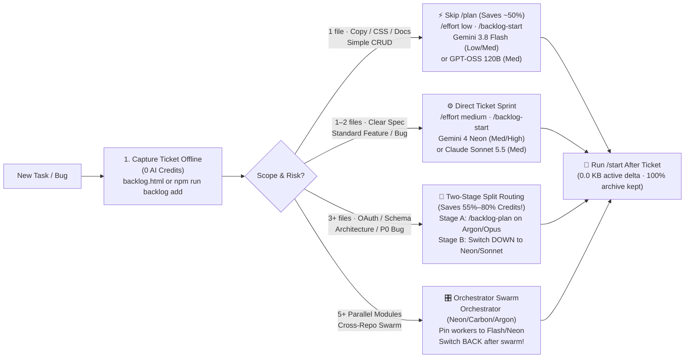

# 💰 Antigravity Credits CheatSheet — AGY 3-Family Model & Quality-to-Credit ROI Guide

> **Mission (Job-To-Be-Done):** Save Antigravity credits while maximizing your **Quality-to-Used-Credits Ratio (`Q/C ROI`)** on every ticket — synchronized with all **27 deployed AGY model/effort variants** across **Google Gemini**, **External Partner Models**, and **Google Orchestrators**.
>
> **Living Maintenance Rule:** Whenever Antigravity (AGY) deploys, renames, or retires models, update this **Credits CheatSheet** (`docs/CREDITS_CHEATSHEET.md` & `templates/docs/CREDITS_CHEATSHEET.md`), `scripts/lint-memory.mjs`, and `scripts/backlog.mjs`, then run `upgrade` to sync every installed Memory Bank project automatically.

---

## 🧭 1. 10-Second Decision Flowchart (Before You Type a Prompt)

---

## ⚖️ 2. Full AGY 3-Family Model Reference & Dual Quota-Pool Balancing

> [!TIP]
> **Dual Quota-Pool Secret (Two Independent 4-Hour Reset Clocks):**
> - **Quota Pool 1 (Google):** All **Google Gemini** models + all **Google Orchestrators** share one quota clock.
> - **Quota Pool 2 (External):** **Claude Sonnet 5.5**, **Claude Opus 5.5**, and **GPT-OSS 120B** share a *separate* quota clock.
> - **Pro Move:** If Pool 1 drops below `30%`, shift daily work to **Claude Sonnet 5.5 (Med)** or **GPT-OSS 120B (Med)** instead of hitting a wall or enabling paid overage!

### 🔵 Family 1 — Google Gemini Models *(Quota Pool 1: Google)*

| Model & Effort Variants | Credit Burn | Sweet Spot & Best Tickets | Avoid Using For |
| :--- | :---: | :--- | :--- |
| **Gemini 3.8 Flash** *(Low / Medium / High)* | **`1.0x`** *(Baseline)* | Boilerplate UI, CSS, copy tweaks, docs formatting, unit test runs, and browser/research subagents | Complex multi-file architecture or P0 concurrency bugs |
| **Gemini 4 Hydrogen** *(Low / Medium / High / **XHigh**)* | **`1.3x–2.0x`** *(Agile)* | Agile Gemini 4 coding; **`XHigh`** gives deep reasoning bursts on single-module algorithms without full Argon cost | Large cross-repo migrations |
| **Gemini 4 Neon** *(Low / Medium / High / **XHigh**)* | **`2.0x–3.0x`** *(Best Daily ROI)* | **Premier daily-driver sweet spot for 80% of feature & bug tickets** and executing approved `/backlog-plan` sub-tickets | Trivial 1-line copy tweaks (use Flash) |
| **Gemini 4 Carbon** *(Low / Medium / High)* | **`3.5x–4.5x`** *(Deep Systems)* | Deep multi-file systems engineering, backend/DB adapters, OAuth flows, and complex state machines | Routine CSS/docs formatting |
| **Gemini 4 Argon** *(Low / Medium / High)* | **`5.0x–7.0x`** *(Frontier Architect)* | Heavyweight frontier architect — **reserve for 1–2 turn `/backlog-plan`**, cross-repo contracts, and P0 root-cause diagnosis | Leaving active for 10+ implementation/test-fix turns |

---

### 🟠 Family 2 — External Partner Models *(Quota Pool 2: Independent Reset Clock)*

| Model & Effort Variants | Credit Burn | Sweet Spot & Best Tickets | Avoid Using For |
| :--- | :---: | :--- | :--- |
| **GPT-OSS 120B** *(Medium)* | **`1.5x`** *(Open-Weight Offload)* | High-efficiency external offload for routine coding, scaffolding, boilerplate, or second-opinion reviews while preserving Google & Claude quota | Deep multi-file UI/UX design surgery |
| **Claude Sonnet 5.5** *(Low / Medium / High)* | **`2.5x–4.0x`** *(Surgical Code)* | Surgical TypeScript/React/UI component implementation and multi-file refactoring *(External Pool twin of Gemini 4 Neon / Carbon)* | Running bulk repetitive lint/docs commands |
| **Claude Opus 5.5** *(Low / Medium / High)* | **`6.0x–9.0x`** *(Heavyweight Frontier)* | Strictly for **1-turn `/backlog-plan` blueprints**, security audits, or stubborn P0 bugs | **Never** leave active for routine iterative test-fix loops! |

---

### 🟣 Family 3 — Google Orchestrators *(Quota Pool 1: Multi-Agent / Swarm Coordinators)*

| Orchestrator Variant | Model ID | Credit Multiplier | Best Use Case |
| :--- | :--- | :---: | :--- |
| **Orchestrator (Neon)** | `gemini-pro-orchestrator-neon` | **`3.0x–4.5x`** | Coordinator for lightweight `2–3` worker parallel tasks (`swarm` / `/teamwork`) |
| **Orchestrator (Carbon)** | `gemini-pro-orchestrator` | **`4.5x–6.5x`** | Coordinator for multi-module feature pipelines and cross-layer refactors |
| **Orchestrator (Argon)** | `gemini-pro-orchestrator-argon` | **`6.5x–10.0x`** | Frontier coordinator for large-scale repository migrations or multi-agent architectural audits |

> [!WARNING]
> **Explicit Orchestrator Credit Warning (`3x–6x` Fan-Out Multiplier):**
> Orchestrators spawn and coordinate multiple turns and subagent workers automatically. **NEVER leave an Orchestrator selected for single-agent ticket execution (1–3 file tasks)** — always switch back to **Gemini 4 Neon** or **Gemini 3.8 Flash** as soon as your swarm finishes!

---

## 🔀 3. Backlog-First & Two-Stage Split Routing (Save `55%–80%` Credits)

1. **Always Create a Backlog Ticket Offline First (`0 AI Tokens`)**:
   - Use the Review pane (`backlog.html` → **➕ Quick Capture Task**) or CLI (`npm run backlog add "<Title>" --components "<files>"`).
   - Pre-defining target files and `.zip`/spec attachments offline eliminates `2–4` exploratory chat turns (**`~15k–30k` tokens saved immediately**).
2. **Know When to Skip `/plan` vs. Spend Separate Planning Credits**:
   - **Skip Separate `/plan` (`1–2` files, low ambiguity)**: A formal planning turn (`~4k` tokens) costs as much as the fix itself. Jump straight to `/effort low /backlog-start <ID>` or `/effort medium /backlog-start <ID>`.
   - **Use Two-Stage Split Model Routing (`3+` files, OAuth/DB, P0 bugs)**:
     - **Stage A — Plan (`1–2` turns on Frontier):** Select **Gemini 4 Argon/Carbon (High)** or **Claude Opus 5.5 (Med/High)** and run `/effort high /backlog-plan <ID>` to lock `implementation_plan.md` and split atomic sub-tickets (`npm run backlog split`).
     - **Stage B — Execute (Switch Model DOWN):** Before clicking **Proceed**, switch to **Gemini 4 Neon (Medium)** or **Claude Sonnet 5.5 (Medium)** (or **Gemini 3.8 Flash** for simple sub-tickets) to execute each atomic ticket — delivering frontier architecture at workhorse credit cost!

---

## ⚡ 4. Quick-Reference Controls & Anti-Bleed Checklist

| Command / Control | What It Does | When to Run It |
| :--- | :--- | :--- |
| **`npm run backlog advise [ID]`** | Prints verbose ticket-specific AGY model & Q/C ROI prescription | Before starting any ticket |
| **`/start`** | Auto-runs `/clear` & `/compact` pre-flight (`0.0 KB` active delta, 100% archive kept) | Immediately after finishing **every** ticket |
| **`/effort [low\|medium\|high\|xhigh]`** | Sets reasoning depth, turn cap (`≤ 4/6/8`), and outputs model guide | Whenever task complexity shifts |
| **`/credits`** · **`/usage`** · **`/context`** | Audits per-turn token drain, progressive disclosure savings & quota tips | Weekly or if responses feel slow/heavy |
| **Overage Toggle = `OFF`** | Enforces a hard stop at your 20x baseline limit (zero surprise top-up burn) | Keep **OFF** in Google One / Antigravity Settings |
