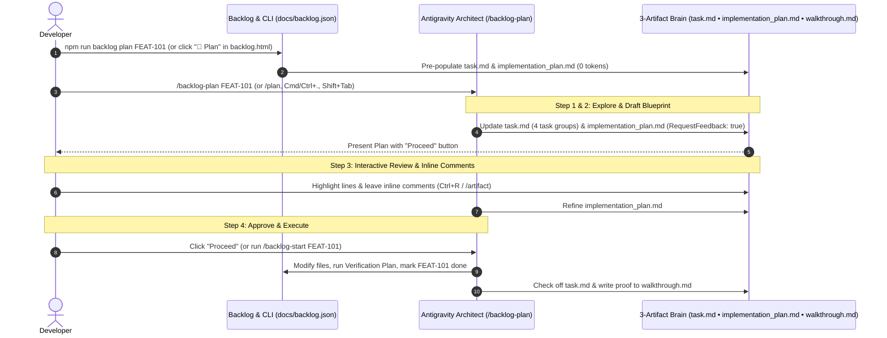

# Antigravity Planning Mode & Backlog Correlation — Installation & User Guide 📐

In Antigravity, **Planning Mode** transforms the agent from an immediate code generator into an autonomous software architect that explores your codebase, maps out dependencies, and aligns with you on an architectural blueprint *before* touching a single production file.

Every project initialized (`init`) or updated (`upgrade`) with `antigravity-memory-bank` automatically installs all **Planning Mode** prerequisites (`/backlog-plan` skill, `docs/PLANNING_GUIDE.md`, `npm run backlog:plan`, and the `📐 Plan` Kanban actions) and correlates the **3-Artifact Lifecycle** 1-to-1 with your **Local Backlog (`docs/backlog.json`)** and **Three-Tier Memory Bank (`memory-bank/*.md`)**.

---

## 1. Installation & Automatic Pre-Population for Existing Projects

### Installing or Upgrading Planning Mode
```bash
# Initialize in a new or existing project (installs Memory Bank + Backlog + 3-Artifact Planning Mode):
npx github:johnny-saigon/antigravity-memory-bank init -y --commit

# Or upgrade an existing Memory Bank installation in-place (preserves 100% of custom memory-bank/*.md files):
npx github:johnny-saigon/antigravity-memory-bank upgrade -y --commit
# (Or run: npm run memory:upgrade)
```

### What Gets Installed & Pre-Populated Automatically
1. **3 Correlated Planning Artifacts (`docs/planning/` & `~/.gemini/antigravity/brain/<session-id>/`)**:
   - `task.md`: Live 4-group checklist correlated 1-to-1 with `docs/backlog.json`.
   - `implementation_plan.md`: Formal 4-section architectural blueprint.
   - `walkthrough.md`: Cumulative execution summary and verification proof.
2. **Pre-Population for Already-Advanced Projects**:
   - When run on an existing or advanced codebase, `init` and `upgrade` automatically extract your **Project North Star** (`memory-bank/projectbrief.md`), **Current Phase & Sprint Objective** (`memory-bank/activeContext.md`), **Tier 2 Infrastructure Guardrails** (`.agents/rules/infra.md`), **Active & Queued Backlog Tickets** (`docs/backlog.json`), and **Completed Milestones & Test Matrix** (`memory-bank/progress.md`).
   - All 3 artifacts are immediately populated with your project's real state so every project uses the same structured approach.
   - **Non-Destructive Inline Edit Protection**: Auto-generated planning artifacts carry an `<!-- antigravity-planning-sync -->` header. If you or the agent manually customize `implementation_plan.md` without that marker, automatic background renders preserve your manual edits until you explicitly run `npm run backlog plan <ID>` or pass `--force`.
3. **Skills, CLI Scripts & Kanban Controls**:
   - `.agents/skills/backlog-plan/SKILL.md` (`/backlog-plan` slash command)
   - `npm run backlog:plan` (`node scripts/backlog.mjs plan [<ID>]`)
   - **3-Artifact Planning Lifecycle Bar** & **`📐 Plan`** card buttons in `backlog.html` (backed by `POST http://127.0.0.1:4199/api/plan`)

---

## 2. How the Planning Mode Workflow Operates



When you trigger Planning Mode (by selecting **Planning** in the mode picker, pressing **`Cmd/Ctrl + .`** or **`Shift + Tab`**, typing **`/plan`**, or invoking **`/backlog-plan <TICKET_ID>`**), Antigravity moves through a structured **3-Artifact Lifecycle** stored inside its session brain (`~/.gemini/antigravity/brain/<session-id>/`) and mirrored in `docs/planning/`:

1. **Context Discovery & `task.md` Creation:**
   The agent searches your repository, reads your project rules (`GEMINI.md` and `AGENTS.md`), ingests `memory-bank/*.md` and `docs/backlog.json`, and updates **`task.md`**—a live checklist broken into 4 task groups (**1. Context Discovery & Architectural Baseline**, **2. Active Sprint & Planning Focus (`In Progress`)**, **3. Queued Backlog (`To-Do`)**, and **4. Completed & Verified Engineering Tasks (`Done`)**) correlated 1-to-1 with your backlog ticket IDs.
2. **Drafting `implementation_plan.md`:**
   Instead of writing code right away, the agent compiles its findings into a formal design document (`implementation_plan.md`). When your Artifact Review Policy is set to **Request Review** (or `RequestFeedback: true`), the agent pauses execution and presents the plan with a **Proceed** button.
3. **Interactive Review & Iteration:**
   You review the plan, highlight specific lines to leave **Google Docs-style inline comments**, or reply in chat. The agent re-enters Planning Mode, researches any new constraints you pointed out, and updates `implementation_plan.md`.
4. **Execution & `walkthrough.md`:**
   Once you click **Proceed** (or run `/backlog-start <TICKET_ID>`), the agent switches to Execution Mode, checks off items in `task.md` in real time as it modifies files, runs verification tests, updates `docs/backlog.json`, and concludes by updating **`walkthrough.md`**—a summary of all changes made and proof of verification.

---

## 3. Anatomy of an `implementation_plan.md`

Understanding how Antigravity structures `implementation_plan.md` tells you exactly where to look when reviewing a complex feature:

| Section | What the Agent Puts Here | What You Should Check |
| :--- | :--- | :--- |
| **1. Goal Description** | A concise summary of the problem, North Star context from `memory-bank/`, and what the target backlog ticket(s) accomplish. | Verify the agent actually understood your core user journey and constraints. |
| **2. User Review Required** | Highlighted with `IMPORTANT` or `WARNING` callouts. Lists breaking changes, architectural trade-offs, Tier 2 cluster invariants, unverified assumptions, or **Strict Live E2E Verification** warnings for OAuth/third-party integrations. | **Read this first.** If the agent had to guess on an App Group name, API payload format, or third-party credential, it flags it here. |
| **3. Proposed Changes** | Files grouped logically by ticket/component/module (dependencies first), marked with `[NEW]`, `[MODIFY]`, or `[DELETE]`, plus targeted code diffs for key interfaces or schemas. | Check for "scope creep" (files the agent shouldn't touch) or missing edge cases (e.g., forgetting to update `Info.plist`, entitlements, or `.env.example`). |
| **4. Verification Plan** | Concrete terminal commands (unit tests, typechecks, build scripts, live health probes) and manual/live E2E testing steps the agent will run after coding. | Ensure the build/test commands match your actual local and production environment so the agent doesn't get stuck in a broken test loop. |

---

## 4. Step-by-Step Usage Guide (CLI, Review Pane & Chat)

### A. Offline CLI Planning (`0 AI Tokens`)
All planning artifacts are pre-populated and kept synchronized with `docs/backlog.json` at **0 AI token cost**:

```bash
# Synchronize all 3 Planning Mode artifacts with docs/backlog.json and memory-bank/*.md:
npm run backlog:plan

# Focus implementation_plan.md and task.md on specific backlog ticket(s) (and copy /backlog-plan <ID> to clipboard):
npm run backlog plan FEAT-101
npm run backlog plan FEAT-101, BUG-102

# Force-regenerate planning artifacts even if manually edited:
npm run backlog plan FEAT-101 --force

# Refresh all Review pane Kanban & 3 Planning Mode artifacts (task.md, implementation_plan.md, walkthrough.md):
npm run backlog render
```

### B. Interactive Review Pane Kanban (`backlog.html`)
1. Open `backlog.html` in the Antigravity Review pane (or browser).
2. At the top of the board, the **3-Artifact Planning Lifecycle Bar** displays live status badges for `task.md`, `implementation_plan.md`, and `walkthrough.md`, plus a **`🔄 Sync 3 Planning Artifacts`** button.
3. Click **"📐 Plan"** directly on any active ticket card inside `backlog.html`:
   - Calls `POST http://127.0.0.1:4199/api/plan` to focus `implementation_plan.md` and `task.md` on that ticket.
   - Copies `/backlog-plan <TICKET_ID>` directly to your OS clipboard (`pbcopy`).

### C. In Antigravity Chat (`/backlog-plan` → Review → `/backlog-start`)
```text
# 1. Generate & refine the architectural plan for a ticket (pauses for review):
/backlog-plan FEAT-101

# 2. Or anchor specific files/directories or UX/UI .zip bundles in your plan prompt:
/backlog-plan FEAT-101 @src/services/
```
Once you approve the plan (click **Proceed** or finish inline comments), execute with:
```text
/backlog-start FEAT-101
```

---

## 5. Best Practices for Planning Mode

### 1. Separate Exploration from Planning on Unfamiliar Code (`Explore → Plan → Execute`)
Even with Planning Mode enabled, jumping straight into a massive feature prompt can lead to shallow plans if the codebase is large. Follow the **Explore → Plan → Execute** pattern:
- **Step 1 (Explore):** *"Explain how image uploads and deep links are currently routed in `@src/`."*
- **Step 2 (Plan):** Once the agent maps the exact files into its context window, run `/backlog-plan <ID>` or `/plan` with your feature prompt. The resulting `implementation_plan.md` will be grounded in your actual architecture rather than generic boilerplate.

### 2. Anchor Context with `@`-Mentions, Visuals & `.zip` Bundles
Don't make the agent guess where your critical files live:
- Use **`@file` or `@directory` autocomplete** in your prompt to point directly to existing state managers, API clients, or configuration files.
- If you have a UI mockup, an Xcode error screenshot, or an architecture diagram, copy it and press **`Ctrl+V` / `Cmd+V`** directly into the prompt box, or attach UX/UI `.zip` bundles via `npm run backlog attach <ID> <path>` (or the `📎` button in `backlog.html`).

### 3. Use Inline Artifact Comments Instead of Long Chat Replies
When `implementation_plan.md` needs adjustments, resist the urge to write a 5-paragraph correction in the main chat box:
- Open the `implementation_plan.md` artifact (click it in the IDE Review panel, or press **`Ctrl+R`** / type **`/artifact`** in the CLI).
- **Highlight the exact file path or proposed function signature** and attach an inline comment (e.g., *"Use `UserDefaults(suiteName:)` here instead of Keychain"*).
- Inline comments bind your feedback to the exact line of the plan, preventing the agent from accidentally rewriting parts of the plan you already liked.

### 4. Enforce a Strict Verification Loop in the Plan
An implementation plan is only as good as its **Verification Plan** section. Before clicking **Proceed**:
- Check Section 4 at the bottom of `implementation_plan.md`. If the Verification Plan looks vague (e.g., *"Verify the app builds"*), leave a comment specifying the exact command (e.g., *"Run `xcodebuild -scheme SnapCal -sdk iphonesimulator build` to verify compilation"* or *"Run `npm test`"*).
- When the agent has a concrete terminal command in its plan, it automatically runs that command during execution and self-heals any compiler or type errors before handing the work back to you.
- **Strict Live E2E Verification Before Closure**: Never mark any ticket involving third-party integrations, OAuth providers, or external credentials as `done` until live server credentials are configured and a real end-to-end test passes.

### 5. Bake Recurring Constraints into `GEMINI.md` or `AGENTS.md`
If you find yourself leaving the same review comments on every `implementation_plan.md` (such as *"Never use deprecated iOS APIs"*, *"Always use Swift Testing instead of XCTest"*, or *"Keep bundle IDs prefixed with `com.snapcal`"*), add them to `AGENTS.md` or `memory-bank/systemPatterns.md` in your workspace root. Antigravity automatically loads these files at the start of every session and applies those constraints while drafting the initial plan.

### 6. Use `/fork` When Weighing Two Architectural Approaches
If the agent presents a plan and you aren't sure whether Approach A or Approach B is better:
- Run **`/fork`** from your approved baseline thread to spin up a parallel branch of the session.
- Let the agent execute the plan in the forked session to see how the code feels. If it turns out too messy, run **`/resume`** to jump straight back to your clean baseline thread and adjust the plan.

### 7. Pair `/plan` with `/effort`, `/clear` & `/context` to Stop Credit Bleed (`FEAT-118` & `FEAT-119`)
- **Lock Down `/plan` Before Coding**: Always approve `implementation_plan.md` before letting the agent edit files on complex features or multi-file bugs—reviewing a text plan costs a fraction of a credit compared to reverting broken file edits.
- **Throttle Reasoning with `/effort`**: After locking down the plan, dial down `/effort low` or `/effort medium` if execution is straightforward UI/CRUD wiring, or keep `/effort high` for intricate state or concurrency logic.
- **Verify Rules & Prune History (`/context` & `/clear`)**: Run **`/context`** to verify that `.agents/rules/memory-*.md` (`trigger: model_decision`) are active without root `AGENTS.md` bloat (`< 50 lines`), and run **`/clear`** (then **`/start`**) or **`/compact`** immediately after completing the ticket. Keep the Google One / Antigravity **Overage Toggle disabled** and monitor **`/credits`** and **`/usage`**.

