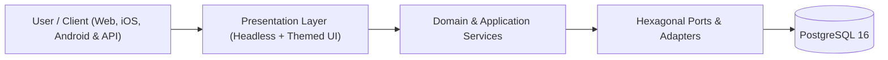

<!-- antigravity-doc-sync -->
# 🧩 antigravity-memory-bank — Logical Architecture (`docs/architecture/LOGICAL_ARCHITECTURE.md`)

> **Index**: [`docs/INDEX.md`](../INDEX.md) · **Memory Baseline**: [`memory-bank/projectbrief.md`](../../memory-bank/projectbrief.md)

## 1. System Context & Domain North Star
- **Project**: **antigravity-memory-bank** — Three-Tier Memory Bank brick and Antigravity plugin for autonomous agentic pair programming
- **Target Platforms**: Web, iOS, Android & API
- **Core Architectural Pattern**: Three-Tier Memory Bank + Decoupled Zero-Token Backlog + Hexagonal Domain/Adapter Isolation.

---

## 2. Core Domain Entities & Shared Hexagonal Bricks

<!-- ag-section:logical-entities:start -->
| Module / Brick | Responsibility | Status |
| :--- | :--- | :--- |
| `core` | Primary domain & application services | 🟢 Active |
| `bricks/user-profile` (`v1.0.0`) | Multi-Platform OAuth 2.0, User Profile & Pluggable Token/Slot UX Brick (google, facebook, apple, microsoft) | 🟢 Installed (web, ios, android) |
<!-- ag-section:logical-entities:end -->

---

## 3. Progressive Feature & Capability Map (`FEAT-*`)

<!-- ag-section:logical-features:start -->
| Feature ID | Capability / Title | Status | Target Components |
| :--- | :--- | :--- | :--- |
| **`FEAT-105`** | Automated Historical Context Scraper (Git, Docs & Antigravity Transcripts) | 🟢 DONE | `lib/context-scraper.mjs`, `bin/cli.mjs` |
| **`FEAT-106`** | Incremental Context Auto-Synchronizer, Git Post-Commit Hook & CI Workflow | 🟢 DONE | `scripts/sync-memory-context.mjs`, `templates/git/hooks/post-commit.tpl`, `templates/github/workflows/memory-bank-sync.yml.tpl` |
| **`FEAT-107`** | Passive Observer Invariant & Operational Board Separation into docs/ | 🟢 DONE | `templates/AGENTS.md.tpl`, `rules/AGENTS.md`, `skills/update-memory/SKILL.md` |
| **`FEAT-108`** | Decoupled Zero-Token Backlog Engine, /backlog-start Skill & Review Pane Kanban | 🟢 DONE | `scripts/backlog.mjs`, `templates/scripts/backlog.mjs`, `skills/backlog-start/SKILL.md` |
| **`FEAT-109`** | Automated Board & Bug Record Adapter During init / upgrade | 🟢 DONE | `lib/backlog-adapter.mjs`, `bin/cli.mjs` |
| **`FEAT-110`** | Dogfooding & Strict Upstream Package Isolation Architecture | 🟢 DONE | `package.json`, `bin/cli.mjs`, `.gitignore` |
| **`FEAT-111`** | Automated Zero-Dependency E2E CLI Test Suite (init, upgrade, sync, export, uninstall) | 🟢 DONE | `bin/cli.mjs`, `scripts/lint-memory.mjs` |
| **`FEAT-112`** | Automated Byte-Parity Check Between scripts/backlog.mjs and templates/scripts/backlog.mjs | 🟢 DONE | `scripts/lint-memory.mjs`, `scripts/backlog.mjs`, `templates/scripts/backlog.mjs` |
| **`FEAT-113`** | Automatic Context & UX/UI .zip Bundle Ingestion in /backlog-start & Backlog Engine | 🟢 DONE | `skills/backlog-start/SKILL.md`, `scripts/backlog.mjs`, `templates/scripts/backlog.mjs` |
| **`FEAT-114`** | On-the-Fly Lifecycle Hooks (.agents/hooks.json), Zero-Manual-Step Memory Registration & 10-Point Mandatory Ingestion Checklist | 🟢 DONE | `lib/ingestion-checklist.mjs`, `lib/customizations-scraper.mjs`, `scripts/sync-memory-context.mjs` |
| **`FEAT-115`** | Enforce Strict Live End-to-End Verification Before Ticket Closure Across AGENTS.md & /backlog-start | 🟢 DONE | `AGENTS.md`, `templates/AGENTS.md.tpl`, `rules/AGENTS.md` |
| **`FEAT-116`** | Correlated 3-Artifact Antigravity Planning Mode (task.md, implementation_plan.md, walkthrough.md) & /backlog-plan Skill | 🟢 DONE | `scripts/backlog.mjs`, `templates/scripts/backlog.mjs`, `skills/backlog-plan/SKILL.md` |
| **`FEAT-117`** | AI-Native Repository & Root Reorganization Engine (organize) | 🟢 DONE | `lib/repo-organizer.mjs`, `bin/cli.mjs`, `lib/ingestion-checklist.mjs` |
| **`FEAT-118`** | Antigravity Native Rule Discovery & model_decision Progressive Disclosure | 🟢 DONE | `AGENTS.md`, `.agents/rules/`, `scripts/lint-memory.mjs` |
| **`FEAT-119`** | Stop the Credit Bleed Controls & Executable Slash-Command Skills (/context, /clear, /effort, /credits, /usage) | 🟢 DONE | `skills/`, `.agents/skills/`, `scripts/lint-memory.mjs` |
| **`FEAT-120`** | Phase 1: Extract SnapCal Multi-Platform OAuth, User Profile & Pluggable UX/UI Brick (bricks/user-profile/) | 🟢 DONE | `bricks/user-profile/brick.json`, `bricks/user-profile/core/`, `bricks/user-profile/platforms/web/` |
| **`FEAT-121`** | Canonical Living Documentation Hierarchy & Deep Universal Harvester (docs/INDEX.md + 4 Pillars) | 🟢 DONE | `lib/docs-synthesizer.mjs`, `scripts/sync-living-docs.mjs`, `templates/scripts/sync-living-docs.mjs` |
| **`FEAT-122`** | Mandatory Plan-to-Backlog Ticket Creation & Atomic Plan Decomposition (backlog split & plan --from-plan) | 🟢 DONE | `scripts/backlog.mjs`, `templates/scripts/backlog.mjs`, `skills/backlog-plan/SKILL.md` |
| **`FEAT-123`** | Auto-Execute /clear & /compact Pre-Flight on Every /start Workflow Across All Installed Memory Banks | 🟢 DONE | `skills/start/SKILL.md`, `.agents/skills/start/SKILL.md`, `scripts/lint-memory.mjs` |
| **`FEAT-124`** | Add per-column and global Sort (Oldest to Newest and vice versa) and manual drag-and-drop / up-down ticket reordering across all Backlog instances | 🟢 DONE | `scripts/backlog.mjs`, `templates/scripts/backlog.mjs` |
<!-- ag-section:logical-features:end -->

---

## 4. Consolidated Project Specifications

<!-- ag-section:legacy-logical:start -->
<!-- harvested-repo-context:start -->
### Harvested Repository & Memory-Bank Context

- **From [`memory-bank/projectbrief.md`](../../memory-bank/projectbrief.md) (Memory Bank Baseline)**:
  - **Product Name**: antigravity-memory-bank
  - **Tagline**: Production-tested Three-Tier Memory Bank brick, Zero-Token Backlog Engine, and Antigravity Plugin for autonomous AI pair programming.
  - **Core Value Proposition**: Prevents context drift, cross-project rule pollution, and token waste by separating global preferences (Tier 1), cluster invariants (Tier 2), and isolated domain memory (Tier 3) alongside a decoupled zero-token local backlog (`docs/backlog.json`).
  - **Platforms**: Node.js CLI (`npx github:johnny-saigon/antigravity-memory-bank`), Antigravity IDE Workspace Plugin & Skills (`/start`, `/backlog-start`, `/update-memory`), Git Hooks & GitHub Actions CI.
  - **Primary Audience**: Developers and autonomous AI coding agents working across single or colocated multi-project repositories.

- **From [`README.md`](../../README.md) (## 🔄 The Continuous Session Lifecycle)**:
  Unlike legacy memory systems that require stopping and manually restarting, this brick uses a **2-Phase Continuous Loop**:
  ### The Two-Phase Lifecycle Breakdown
  Whenever `/update-memory` is triggered (or when a major milestone completes):
  #### Phase 1: Milestone Closure & Git Synchronization
  1. **Git Diff & Status Review**: Inspects working tree changes (`git status -s` and `git diff --stat`) to verify what was modified.
  2. **Context & Progress Updates**: Marks finished acceptance criteria in `memory-bank/progress.md` (`[x]`) and records architectural decisions, schema migrations, and resolved bugs in `memory-bank/activeContext.md`.
  3. **Token Line Budget Audit**: Automatically verifies that every file in `memory-bank/*.md` remains strictly **`< 150 lines`** (via `scripts/lint-memory.mjs`). If a domain expands, it splits into a linked sub-file (`@[Topic](path.md)`).
  4. **Infrastructure Invariant Verification**: Checks that no Tier 2 cluster invariants (`.agents/rules/infra.md`), port allocations, or database boundaries were violated.

- **From [`README.md`](../../README.md) (## ⚡ Automated Self-Updating Architecture)**:
  Once installed, the system keeps itself continuously up-to-date across **two distinct dimensions**:
  ### 1. Context Auto-Updating (Codebase & Commit Synchronization)
  - **Git `post-commit` Hook**: Installed into `.git/hooks/post-commit`. Every `git commit` that introduces new features (`feat:`) or bug fixes (`fix:`) automatically triggers `scripts/sync-memory-context.mjs` in the background. It updates `progress.md` accomplishments and `activeContext.md` sprint state with zero manual typing.
  - **Agent Continuous Cycle (`/update-memory`)**: When pair-programming with Antigravity, the agent executes the 2-phase lifecycle upon task completion—synchronizing diffs, verifying line budgets (< 150 lines), committing to Git, and auto-bootstrapping the next cycle.
  - **CI Context Verification (GitHub Actions)**: `.github/workflows/memory-bank-sync.yml` runs on every PR and push to `main`, validating line budgets (`npm run lint:memory`) and ensuring master branch context is in lockstep with releases.
  ### 2. Tooling & System Auto-Updating (Upstream Brick Upgrades)
  - **Non-Destructive In-Place Upgrade**: Upstream enhancements, new skills, and prompt optimizations in `antigravity-memory-bank` can be pulled non-destructively:
    This updates `.agents/skills/`, `scripts/lint-memory.mjs`, and `.git/hooks/post-commit` while keeping all project-specific domain documents in `memory-bank/*.md` 100% intact.

- **From [`README.md`](../../README.md) (## 📐 5. Structured Planning Mode (`Explore → Plan → Execute`) & 3-Artifact Lifecycle)**:
  In Antigravity, **Planning Mode** transforms the agent from an immediate code generator into an autonomous software architect that explores your codebase, maps out dependencies, and aligns with you on an architectural blueprint *before* touching a single production file.
  Every project initialized (`init`) or updated (`upgrade`) with `antigravity-memory-bank` automatically installs all **Planning Mode** prerequisites (`/backlog-plan` skill, `docs/PLANNING_GUIDE.md`, `npm run backlog:plan`, and the `📐 Plan` Kanban actions) and correlates the **3-Artifact Lifecycle** 1-to-1 with your **Local Backlog (`docs/backlog.json`)** and **Three-Tier Memory Bank (`memory-bank/*.md`)**.
  ---
  ### 5.1 How the Planning Mode Workflow Operates
  When you trigger Planning Mode (by selecting **Planning** in the mode picker, pressing **`Cmd/Ctrl + .`** or **`Shift + Tab`**, typing **`/plan`**, or invoking **`/backlog-plan <TICKET_ID>`**), Antigravity moves through a structured **3-Artifact Lifecycle** stored inside its session brain (`~/.gemini/antigravity/brain/<session-id>/`) and mirrored in `docs/planning/`:
  1. **Context Discovery & `task.md` Creation (`docs/planning/task.md` & `<brainDir>/task.md`):**
     The agent searches your repository, reads your project rules (`GEMINI.md` and `AGENTS.md`), ingests `memory-bank/*.md` and `docs/backlog.json`, and updates **`task.md`**—a live checklist broken into 4 correlated task groups:
     - **1. Context Discovery & Architectural Baseline**

- **From [`README.md`](../../README.md) (## 🔒 7. Dogfooding & Upstream Package Isolation Architecture)**:
  `antigravity-memory-bank` dogfoods its own **Three-Tier Memory Bank** (`memory-bank/*.md`, `AGENTS.md`, `.agents/`) and **Decoupled Zero-Token Backlog Engine** (`docs/backlog.json`, `docs/BACKLOG.md`) directly inside this repository while guaranteeing **zero interference** with clean installations in downstream projects:
  1. **Strict `package.json` Distribution Whitelist (`"files"`)**:
     - The `"files"` array in [`package.json`](package.json) explicitly whitelists only the distributable engine directories (`bin/`, `lib/`, `rules/`, `scripts/`, `skills/`, `templates/`, `plugin.json`, `install.sh`).
     - Internal dogfood state (`memory-bank/`, `docs/`, `.agents/`, `AGENTS.md`, `.github/`) is excluded from packaged npm/`npx` tarballs.
  2. **Template-Only Downstream Generation**:
     - [`bin/cli.mjs`](bin/cli.mjs) scaffolds downstream projects exclusively from `templates/`, `skills/`, `rules/`, `lib/`, and `scripts/`. It never reads from the repository's root `memory-bank/`, `docs/`, `AGENTS.md`, or `.agents/`.
  3. **Self-Repository Guard (`isSelfRepo`)**:
     - `detectProjectContext()` in [`bin/cli.mjs`](bin/cli.mjs) detects when the CLI is invoked inside the upstream `antigravity-memory-bank` repository (`detected.isSelfRepo`).

- **From [`README.md`](../../README.md) (## 🛠️ 8. Repository Scripts)**:
  | Script | Command | Description |
  | :--- | :--- | :--- |
  | **Backlog Board** | `npm run backlog` | Lists tasks and provides zero-token backlog CLI controls |
  | **List Backlog** | `npm run backlog:list` | Displays backlog with status icons and priority tags |
  | **Add Task** | `npm run backlog:add "<title>"` | Captures a task offline into docs/backlog.json (0 tokens) |
  | **Plan Task** | `npm run backlog:plan [<id>]` | Generates/syncs 3-artifact Planning Mode (`task.md`, `implementation_plan.md`, `walkthrough.md`) |
  | **Start Task** | `npm run backlog:start <id>` | Marks task in-progress and outputs 1-line kickoff prompt |
  | **Complete Task** | `npm run backlog:done <id>` | Marks task completed and refreshes Review pane board |
<!-- harvested-repo-context:end -->
<!-- ag-section:legacy-logical:end -->
