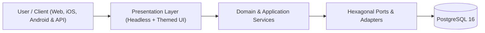

<!-- antigravity-doc-sync -->
# 🧩 antigravity-memory-bank — Logical Architecture (`docs/architecture/LOGICAL_ARCHITECTURE.md`)

> **Index**: [`docs/INDEX.md`](../INDEX.md) · **Memory Baseline**: [`memory-bank/projectbrief.md`](../../memory-bank/projectbrief.md)

## 1. System Context & Domain North Star
- **Project**: **antigravity-memory-bank** — Three-Tier Memory Bank brick and Antigravity plugin for autonomous agentic pair programming
- **Target Platforms**: Web, iOS, Android & API
- **Core Architectural Pattern**: Three-Tier Memory Bank + Decoupled Zero-Token Backlog + Hexagonal Domain/Adapter Isolation.

---

## 2. Core Domain Entities & Shared Hexagonal Bricks

<!-- ag-section:logical-entities:start -->
| Module / Brick | Responsibility | Status |
| :--- | :--- | :--- |
| `core` | Primary domain & application services | 🟢 Active |
| `bricks/user-profile` (`v1.0.0`) | Multi-Platform OAuth 2.0, User Profile & Pluggable Token/Slot UX Brick (google, facebook, apple, microsoft) | 🟢 Installed (web, ios, android) |
<!-- ag-section:logical-entities:end -->

---

## 3. Progressive Feature & Capability Map (`FEAT-*`)

<!-- ag-section:logical-features:start -->
| Feature ID | Capability / Title | Status | Target Components |
| :--- | :--- | :--- | :--- |
| **`FEAT-102`** | On-the-Fly CLI Initializer & Universal One-Line Shell Installer | 🟢 DONE | `bin/cli.mjs`, `install.sh` |
| **`FEAT-103`** | Consolidated Context Export & Zero-Loss Clean Deinstallation | 🟢 DONE | `bin/cli.mjs` |
| **`FEAT-104`** | Non-Destructive In-Place Upgrade Workflow for Existing Installations | 🟢 DONE | `bin/cli.mjs` |
| **`FEAT-105`** | Automated Historical Context Scraper (Git, Docs & Antigravity Transcripts) | 🟢 DONE | `lib/context-scraper.mjs`, `bin/cli.mjs` |
| **`FEAT-106`** | Incremental Context Auto-Synchronizer, Git Post-Commit Hook & CI Workflow | 🟢 DONE | `scripts/sync-memory-context.mjs`, `templates/git/hooks/post-commit.tpl`, `templates/github/workflows/memory-bank-sync.yml.tpl` |
| **`FEAT-107`** | Passive Observer Invariant & Operational Board Separation into docs/ | 🟢 DONE | `templates/AGENTS.md.tpl`, `rules/AGENTS.md`, `skills/update-memory/SKILL.md` |
| **`FEAT-108`** | Decoupled Zero-Token Backlog Engine, /backlog-start Skill & Review Pane Kanban | 🟢 DONE | `scripts/backlog.mjs`, `templates/scripts/backlog.mjs`, `skills/backlog-start/SKILL.md` |
| **`FEAT-109`** | Automated Board & Bug Record Adapter During init / upgrade | 🟢 DONE | `lib/backlog-adapter.mjs`, `bin/cli.mjs` |
| **`FEAT-110`** | Dogfooding & Strict Upstream Package Isolation Architecture | 🟢 DONE | `package.json`, `bin/cli.mjs`, `.gitignore` |
| **`FEAT-111`** | Automated Zero-Dependency E2E CLI Test Suite (init, upgrade, sync, export, uninstall) | 🟢 DONE | `bin/cli.mjs`, `scripts/lint-memory.mjs` |
| **`FEAT-112`** | Automated Byte-Parity Check Between scripts/backlog.mjs and templates/scripts/backlog.mjs | 🟢 DONE | `scripts/lint-memory.mjs`, `scripts/backlog.mjs`, `templates/scripts/backlog.mjs` |
| **`FEAT-113`** | Automatic Context & UX/UI .zip Bundle Ingestion in /backlog-start & Backlog Engine | 🟢 DONE | `skills/backlog-start/SKILL.md`, `scripts/backlog.mjs`, `templates/scripts/backlog.mjs` |
| **`FEAT-114`** | On-the-Fly Lifecycle Hooks (.agents/hooks.json), Zero-Manual-Step Memory Registration & 10-Point Mandatory Ingestion Checklist | 🟢 DONE | `lib/ingestion-checklist.mjs`, `lib/customizations-scraper.mjs`, `scripts/sync-memory-context.mjs` |
| **`FEAT-115`** | Enforce Strict Live End-to-End Verification Before Ticket Closure Across AGENTS.md & /backlog-start | 🟢 DONE | `AGENTS.md`, `templates/AGENTS.md.tpl`, `rules/AGENTS.md` |
| **`FEAT-116`** | Correlated 3-Artifact Antigravity Planning Mode (task.md, implementation_plan.md, walkthrough.md) & /backlog-plan Skill | 🟢 DONE | `scripts/backlog.mjs`, `templates/scripts/backlog.mjs`, `skills/backlog-plan/SKILL.md` |
| **`FEAT-117`** | AI-Native Repository & Root Reorganization Engine (organize) | 🟢 DONE | `lib/repo-organizer.mjs`, `bin/cli.mjs`, `lib/ingestion-checklist.mjs` |
| **`FEAT-118`** | Antigravity Native Rule Discovery & model_decision Progressive Disclosure | 🟢 DONE | `AGENTS.md`, `.agents/rules/`, `scripts/lint-memory.mjs` |
| **`FEAT-119`** | Stop the Credit Bleed Controls & Executable Slash-Command Skills (/context, /clear, /effort, /credits, /usage) | 🟢 DONE | `skills/`, `.agents/skills/`, `scripts/lint-memory.mjs` |
| **`FEAT-120`** | Phase 1: Extract SnapCal Multi-Platform OAuth, User Profile & Pluggable UX/UI Brick (bricks/user-profile/) | 🟢 DONE | `bricks/user-profile/brick.json`, `bricks/user-profile/core/`, `bricks/user-profile/platforms/web/` |
| **`FEAT-121`** | Canonical Living Documentation Hierarchy & Auto-Synthesizer | 🟢 DONE | `lib/docs-synthesizer.mjs`, `scripts/sync-living-docs.mjs`, `lib/repo-organizer.mjs` |
<!-- ag-section:logical-features:end -->

---

## 4. Consolidated Project Specifications

<!-- ag-section:legacy-logical:start -->
_No legacy logical architecture documents merged yet._
<!-- ag-section:legacy-logical:end -->
