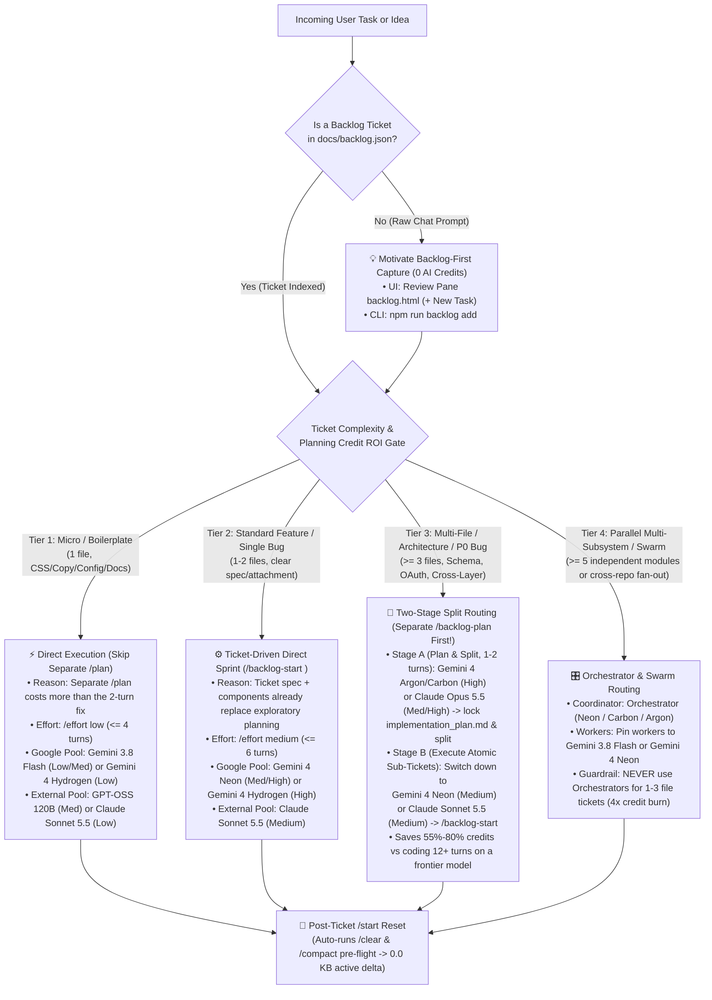

# Implementation Plan — Evolving the Save Credits Paradigm for AGY's Full Model Roster & Ticket Quality-to-Credit ROI (`FEAT-125`..`FEAT-127`)

## 1. Goal Description

### 1.1 Diagnostic Analysis of the Current "Save Credits" Paradigm
Our first-generation **Stop the Credit Bleed** system (`FEAT-118`, `FEAT-119`, `FEAT-122`, `FEAT-123`) solved **context & history inflation** through:
1. **Native Progressive Disclosure (`< 50` lines `AGENTS.md` + `trigger: model_decision`)**: Deferring ~4,500 tokens/turn of domain memory until needed.
2. **Non-Destructive Compaction Watermark (`/start` auto-runs `/clear` & `/compact` pre-flight)**: Resetting active session delta to `0.0 KB` between tasks while preserving 100% of `transcript.jsonl` on disk.
3. **Hard Tool-Turn Budgets (`≤ 4 / 6 / 8` turns)** and **Google One / Antigravity Overage Toggle Hard-Stop**.

However, inspecting [scripts/lint-memory.mjs](file:///Users/jbb/Documents/antigravity-memory-bank/scripts/lint-memory.mjs#L182-L202) and `.agents/skills/{effort,credits,usage}/SKILL.md` against the **live deployed Antigravity (AGY) model roster** reveals four critical gaps:
1. **Outdated 3-Model Placeholder Roster**: `lint-memory.mjs` currently references generic legacy names (`Gemini Flash`, `Gemini Pro`, `Claude Sonnet`) and only 3 effort tiers (`low`, `medium`, `high`). In reality, AGY deploys **27 concrete model/effort variants across 3 distinct model families and 2 separate quota reset pools**:
   - **Family 1 — Google Gemini Models (Shared Google Quota Pool)**:
     - `Gemini 3.8 Flash (Low | Medium | High)` (`gemini-3.8-flash-{low,medium,high}`)
     - `Gemini 4 Hydrogen (Low | Medium | High | XHigh)` (`gemini-4-hydrogen-{low,medium,high,xhigh}`)
     - `Gemini 4 Neon (Low | Medium | High | XHigh)` (`gemini-4-neon-{low,medium,high,xhigh}`)
     - `Gemini 4 Carbon (Low | Medium | High)` (`gemini-4-carbon-{low,medium,high}`)
     - `Gemini 4 Argon (Low | Medium | High)` (`gemini-4-argon-{low,medium,high}`)
   - **Family 2 — Google Orchestrators (Shared Google Quota Pool — Multi-Agent / Swarm / Pipeline Coordinators)**:
     - `Orchestrator (Neon)` (`gemini-pro-orchestrator-neon`)
     - `Orchestrator (Carbon)` (`gemini-pro-orchestrator`)
     - `Orchestrator (Argon)` (`gemini-pro-orchestrator-argon`)
   - **Family 3 — External Partner & Open-Weight Models (Separate External Quota Pool)**:
     - `Claude Sonnet 5.5 (Low | Medium | High)` (`claude-sonnet-5-5-{low,medium,high}`)
     - `Claude Opus 5.5 (Low | Medium | High)` (`claude-opus-5-5-{low,medium,high}`)
     - `GPT-OSS 120B (Medium)` (`gpt-oss-120b-medium`)
2. **Terse Output Instead of Verbose Quality-to-Credit ROI Coaching**: The current CLI (`--effort`, `--credits`, `--usage`) prints 4 short bullets. It does not explain *why* a specific model + effort combination maximizes the **Quality-to-Used-Credits Ratio (`Q/C ROI`)** for the user's specific ticket, nor how to balance across the **Google Quota Pool** and **External Quota Pool**.
3. **Missing Two-Stage Split Model Routing (Separate Planning Credits vs. Execution Credits)**:
   - Jumping straight into coding a complex ticket on a heavyweight model (`Claude Opus 5.5 (High)`, `Gemini 4 Argon (High)`, or `Orchestrator (Argon)`) burns frontier credits across 8–15 file-reading, editing, and test-running turns.
   - Conversely, coding a complex ticket directly on a lightweight model without a plan leads to architectural mistakes, regressions, and 3x more retry turns.
   - The highest **Quality-to-Credit Ratio** comes from **Two-Stage Split Routing**:
     - **Stage 1 (Plan & Decompose — High Intelligence, Low Token Volume)**: Spend `1–2` turns on a frontier architect model (`Gemini 4 Argon (High)`, `Gemini 4 Carbon (High)`, or `Claude Opus 5.5 (Medium/High)`) via `/backlog-plan <ID>` to lock down `implementation_plan.md` and split work into atomic sub-tickets (`npm run backlog split`).
     - **Stage 2 (Atomic Execution — High Speed, High Cost-Efficiency)**: Switch to a fast workhorse model (`Gemini 4 Neon (Medium/High)`, `Gemini 4 Hydrogen (High)`, `Claude Sonnet 5.5 (Medium)`, or `Gemini 3.8 Flash (High)`) to execute each atomic sub-ticket via `/backlog-start <ID>`, running `/start` between sub-tickets.
4. **Proactive Motivation to Create Backlog Tickets First (With Honest Threshold Economics)**:
   - Users need clear, persuasive guidance on **when to create a backlog ticket first (`0 AI tokens`)** and **when to run `/backlog-plan` separately vs. jumping straight into `/backlog-start`**:
     - **Why Backlog Ticket First (`0 AI Tokens`) Always Wins for Any Non-Trivial Work**: Capturing a ticket in `backlog.html` or `npm run backlog add` with target `--components` and `.zip`/spec attachments costs **0 AI credits** and eliminates 2–4 exploratory chat turns (`~15k–30k` tokens saved immediately).
     - **When Separate Planning Credits (`/backlog-plan`) Pay Off vs. Direct Execution (`/backlog-start`)**:
       - **Direct Execution (`Skip /plan`, Jump Straight to `/backlog-start <ID>`)**: For micro-tasks or single-component UI/copy/CRUD tickets (`1–2 files`, low ambiguity), running a separate `/plan` turn would double the token cost (`~4k` planning tokens for a `~4k` execution task). Here, creating/picking the ticket and running `/effort low /backlog-start <ID>` directly on `Gemini 3.8 Flash` or `Gemini 4 Hydrogen` saves ~50% credits.
       - **Separate Planning Turn First (`/backlog-plan <ID>` -> Split -> `/backlog-start <SUB_ID>`)**: Whenever a task touches `>= 3 files`, external OAuth/APIs, DB schemas, concurrency, or P0/High bugs, spending `1` dedicated planning turn upfront prevents mid-implementation architectural U-turns and cuts total session credit burn by **`55%–80%`**.



---

## 2. User Review Required

> [!IMPORTANT]
> **Atomic Backlog Ticket Decomposition (`FEAT-125`, `FEAT-126`, `FEAT-127`)**:
> Following our mandatory Plan-to-Backlog correlation rule (`FEAT-122`), this plan is decomposed into **3 atomic tickets** (`FEAT-125`, `FEAT-126`, `FEAT-127`) that will be registered in [docs/backlog.json](file:///Users/jbb/Documents/antigravity-memory-bank/docs/backlog.json) immediately upon approval (keeping `modifiedFileUris.length === 0` during this `/plan` turn so the blue **Proceed** button renders cleanly above your prompt box).

> [!NOTE]
> **Key Design Decisions for Your Review**:
> 1. **Full 27-Variant AGY Model Taxonomy & Dual Quota-Pool Awareness**:
>    - Every advisory surface (`/effort`, `/credits`, `/usage`, `npm run backlog advise`, and the `backlog.html` Kanban board) will organize recommendations across all three deployed AGY groups:
>      1. **Google Gemini Models** (`Gemini 3.8 Flash`, `Gemini 4 Hydrogen`, `Gemini 4 Neon`, `Gemini 4 Carbon`, `Gemini 4 Argon` across `Low | Medium | High | XHigh`).
>      2. **External Partner Models** (`Claude Sonnet 5.5`, `Claude Opus 5.5` across `Low | Medium | High`, and `GPT-OSS 120B (Medium)`).
>      3. **Google Orchestrators** (`Orchestrator (Neon)`, `Orchestrator (Carbon)`, `Orchestrator (Argon)`).
>    - Includes **Quota-Pool Balancing Guidance**: because Google models/orchestrators share one quota reset timer while Claude/GPT-OSS share an independent external quota reset timer, the advisor explicitly tells the user which cross-pool equivalent to pick when one pool is heavily utilized.
> 2. **Verbose Ticket-Specific Quality-to-Credit (`Q/C ROI`) Advisory**:
>    - Instead of a one-line recommendation, running `/effort`, `/credits`, `/usage`, or `npm run backlog advise [ID]` (or clicking the **💰 Save Credits & Model Advisor** pill on any ticket in `backlog.html`) outputs a verbose breakdown:
>      - **Why Create a Backlog Ticket First (`0 AI Tokens`)**: Quantifies the exact discovery turns and tokens saved (`~15k–30k` tokens) by defining `--components` and attachments offline before prompting the model.
>      - **Separate Planning Credits (`/backlog-plan`) vs. Direct Execution (`/backlog-start`) Decision Verdict**: Explicitly calculates whether the ticket should skip `/plan` (micro/single-file tasks where planning overhead exceeds execution cost) or run a dedicated `/backlog-plan` turn first (multi-file/high-risk tasks where Two-Stage Split Model Routing saves `55%–80%` of frontier credits).
>      - **Stage-by-Stage Model Prescription**: Exact model to select for **Stage 1 (Planning)**, **Stage 2 (Implementation)**, and **Stage 3 (Verification & Docs)** across both Google and External model families, plus explicit **Orchestrator Do/Don't Guardrails**.

---

## 3. Proposed Changes

### [FEAT-125] Verbose AGY Model Roster, Quota-Pool & Ticket Quality-to-Credit ROI Engine (`scripts/lint-memory.mjs`)

#### [MODIFY] [lint-memory.mjs](file:///Users/jbb/Documents/antigravity-memory-bank/scripts/lint-memory.mjs)
- **Expand Effort Tiers to Support `low | medium | high | xhigh | auto`**:
  - Add `xhigh` (`🧠🔥 XHIGH EFFORT — Maximum Frontier Thinking Burst & Adversarial Root-Cause Synthesis`) to match AGY's `Gemini 4 Hydrogen (XHigh)` and `Gemini 4 Neon (XHigh)` variants alongside `Claude Opus 5.5 (High)` and `Gemini 4 Argon (High)`.
- **Build the Deterministic AGY Model Catalog & Ticket Q/C ROI Classifier (`analyzeTicketCreditStrategy(task, requestedTier)`)**:
  - Evaluates a ticket's `type` (`feature`, `bug`, `ux`, `qa`, `refactor`), `priority` (`high`/`P0`, `medium`/`P1`, `low`/`P2`), `components.length`, `attachments.length`, and domain complexity signals (e.g., `oauth|auth|schema|migration|concurrency|webgl|worker|brick|swarm|multi-repo` vs. `css|copy|typo|sort|badge|readme|lint`).
  - Produces a structured, verbose **Ticket Credit-Saving & Model Optimization Report** with 5 sections:
    1. **Backlog-First & Planning Credit Economics Verdict**:
       - Explains whether to **Create Ticket -> Direct `/backlog-start`** (when `components.length <= 2` and complexity is low/medium, saving ~4k planning tokens) OR **Create Ticket -> Separate `/backlog-plan` -> Atomic Split -> `/backlog-start`** (when `components.length >= 3` or priority/risk is high, saving `55%–80%` frontier credits via Two-Stage Split Routing).
       - If no open ticket exists in `docs/backlog.json`, outputs a persuasive **⚠️ No Active Backlog Ticket Detected — Why Creating a Ticket First Saves Credits** callout with ready-to-run `npm run backlog add ...` commands.
    2. **Two-Stage Split Model Routing Matrix (Quality-to-Credit ROI Optimal Pick)**:
       - **Stage A — Architecture & Planning (`/backlog-plan`)**: Exact model recommendation (or `"Skip separate /plan — execute directly"` for Tier 1/2 tasks).
       - **Stage B — Code Implementation (`/backlog-start`)**: Primary **Google Gemini** pick + primary **External Model** equivalent + tool-turn budget (`≤ 4`, `≤ 6`, or `≤ 8` turns).
       - **Stage C — Verification, Tests & Living Docs Sync**: Fast low-burn model recommendation (`Gemini 3.8 Flash (Low/Medium)` or `Gemini 4 Hydrogen (Low)`).
    3. **Full AGY 3-Family Reference & Quota-Pool Balancing Table**:
       - **Google Gemini Family (Google Quota Pool)**:
         - `Gemini 3.8 Flash (Low / Medium / High)`: `1x` credit baseline — best for boilerplate UI, CSS, copy, docs, unit test runs, and browser/research subagents.
         - `Gemini 4 Hydrogen (Low / Medium / High / XHigh)`: `1.3x–2x` — agile Gemini 4 coding; `XHigh` gives deep reasoning bursts on single-module algorithms without full Argon cost.
         - `Gemini 4 Neon (Low / Medium / High / XHigh)`: `2x–3x` — premier daily-driver Quality-to-Credit sweet spot for 80% of feature & bug tickets.
         - `Gemini 4 Carbon (Low / Medium / High)`: `3.5x–4.5x` — deep multi-file systems engineering, backend/DB adapters, and complex state machines.
         - `Gemini 4 Argon (Low / Medium / High)`: `5x–7x` — heavyweight frontier architect; reserve for `/backlog-plan`, cross-repo contracts, and P0 root-cause diagnosis.
       - **External Partner Family (Separate External Quota Pool — Independent Reset Clock)**:
         - `GPT-OSS 120B (Medium)`: `1.5x` external baseline — high-efficiency open-weight option for offloading routine coding, scaffolding, or second-opinion reviews while preserving Google & Claude quota.
         - `Claude Sonnet 5.5 (Low / Medium / High)`: `2.5x–4x` — surgical TypeScript/React/UI component implementation and multi-file refactoring (external counterpart to `Gemini 4 Neon / Carbon`).
         - `Claude Opus 5.5 (Low / Medium / High)`: `6x–9x` — heavyweight external frontier model; use strictly for 1-turn `/backlog-plan` blueprints, security audits, or stubborn P0 bugs (never for routine iterative test-fix loops).
       - **Google Orchestrators (Multi-Agent / Swarm Coordinators — Shared Google Quota Pool)**:
         - `Orchestrator (Neon)` (`gemini-pro-orchestrator-neon`): Coordinator for lightweight 2–3 worker parallel tasks (`swarm` / `/teamwork`).
         - `Orchestrator (Carbon)` (`gemini-pro-orchestrator`): Coordinator for multi-module feature pipelines and cross-layer refactors.
         - `Orchestrator (Argon)` (`gemini-pro-orchestrator-argon`): Frontier coordinator for large-scale repository migrations or multi-agent architectural audits.
         - **Explicit Orchestrator Credit Warning**: Warns that Orchestrators spawn and coordinate multiple turns/workers (`3x–6x` token multiplier); never leave an Orchestrator selected for single-agent ticket execution!
- **Add `--advise [TICKET_ID]` CLI Flag & Enhance `--effort`, `--credits`, `--usage`, `--context`**:
  - `node scripts/lint-memory.mjs --advise [TICKET_ID]` prints the full verbose report for a specific ticket (or all `in_progress`/`todo` tickets).
  - `--effort`, `--credits`, and `--usage` embed this verbose 3-Family AGY Model & Ticket Q/C ROI Advisory directly in their output.

---

### [FEAT-126] Interactive Kanban Credit-Saving & AGY Model Advisor UI + CLI (`scripts/backlog.mjs` & `templates/scripts/backlog.mjs`)

#### [MODIFY] [backlog.mjs](file:///Users/jbb/Documents/antigravity-memory-bank/scripts/backlog.mjs)
#### [MODIFY] [backlog.mjs](file:///Users/jbb/Documents/antigravity-memory-bank/templates/scripts/backlog.mjs)
- **1. New CLI Command `npm run backlog advise [TICKET_ID]` & Enhanced `npm run backlog prompt <TICKET_ID>`**:
  - `npm run backlog advise [TICKET_ID]` (and `npm run backlog prompt <TICKET_ID>`) computes the ticket's complexity score and prints:
    - Recommended **Execution Strategy** (`Direct /backlog-start` vs. `Two-Stage: /backlog-plan First -> Split -> /backlog-start`).
    - Exact **AGY Model Picker Selection** across **Google Gemini**, **External Models**, and **Google Orchestrators**.
    - Exact copy-paste prompt prefixed with the optimal `/effort` level (e.g., `/effort medium /backlog-start FEAT-126` or `/effort high /backlog-plan FEAT-125`).
- **2. Per-Card Quality-to-Credit & Model Recommendation Badge in `backlog.html`**:
  - Every non-completed card on the Kanban board automatically renders an interactive **💡 Credit & Model ROI strip** showing:
    - Recommended `/effort` badge (`⚡ /effort low`, `⚙️ /effort medium`, `🧠 /effort high`, or `🔥 /effort xhigh`).
    - Recommended **Primary AGY Model** (e.g. `Gemini 3.8 Flash`, `Gemini 4 Neon (Med)`, `Plan: Argon/Opus → Exec: Neon/Sonnet`, or `Orchestrator (Carbon)`).
    - **Planning Economics Badge**: `🟢 Direct Start (Skip /plan)` for 1–2 file tasks vs. `📐 Plan Separately First (Saves ~65% Credits)` for 3+ file / high-complexity tickets.
    - Clicking the strip opens the **Verbose Credit & AGY Model ROI Advisor Modal** pre-focused on that ticket!
- **3. Verbose Interactive "💰 Save Credits & AGY Model Advisor" Modal & Top Header Button in `backlog.html`**:
  - Accessible from the top header bar (`💰 Save Credits & Models`) or any ticket card.
  - Displays:
    - **Dynamic Ticket-Specific ROI Prescription** (when opened from a ticket card or when an active ticket is selected):
      - Why creating/refining this ticket offline saved discovery tokens.
      - Whether to run `/backlog-plan <ID>` separately first or jump straight to `/backlog-start <ID>`, with exact 1-click copy buttons for Stage 1 (Plan Prompt + Recommended Architect Model) and Stage 2 (Execution Prompt + Recommended Workhorse Model).
    - **Complete AGY 3-Family Model Matrix & Quota-Pool Guide**:
      - Visual comparison table of **Google Gemini Models** (`3.8 Flash`, `4 Hydrogen`, `4 Neon`, `4 Carbon`, `4 Argon`), **External Models** (`Claude Sonnet 5.5`, `Claude Opus 5.5`, `GPT-OSS 120B`), and **Google Orchestrators** (`Orchestrator Neon / Carbon / Argon`) with relative credit burn multipliers, ideal ticket profiles, and Dual Quota-Pool switching tips.
    - **Quick-Add Modal Coaching Banner**:
      - Inside the `+ New Task` modal in `backlog.html`, adds a live complexity preview that updates as the user types the title, priority, and components—showing in real time how many discovery credits they are saving by creating the ticket before starting work and which AGY model will give the best Quality-to-Credit ratio!

---

### [FEAT-127] Verbose Credit-Saving Skills, Always-On Prescriptive Footer, Living Guides & Cross-Repo Deployment

#### [MODIFY] [SKILL.md](file:///Users/jbb/Documents/antigravity-memory-bank/skills/effort/SKILL.md) & [.agents/skills/effort/SKILL.md](file:///Users/jbb/Documents/antigravity-memory-bank/.agents/skills/effort/SKILL.md)
- Evolve `/effort` to support `low | medium | high | xhigh | auto` and instruct the agent to output a **verbose Quality-to-Credit ROI prescription** covering:
  - The full AGY model mapping across Google Gemini (`3.8 Flash`, `4 Hydrogen`, `4 Neon`, `4 Carbon`, `4 Argon`), External (`Claude Sonnet 5.5`, `Claude Opus 5.5`, `GPT-OSS 120B`), and Orchestrators (`Neon`, `Carbon`, `Argon`).
  - Why creating a backlog ticket first (`0 AI tokens`) and choosing between **Separate Planning (`/backlog-plan`)** vs. **Direct Execution (`/backlog-start`)** maximizes Quality-to-Used-Credits for the current task.

#### [MODIFY] [SKILL.md](file:///Users/jbb/Documents/antigravity-memory-bank/skills/credits/SKILL.md) & [.agents/skills/credits/SKILL.md](file:///Users/jbb/Documents/antigravity-memory-bank/.agents/skills/credits/SKILL.md)
#### [MODIFY] [SKILL.md](file:///Users/jbb/Documents/antigravity-memory-bank/skills/usage/SKILL.md) & [.agents/skills/usage/SKILL.md](file:///Users/jbb/Documents/antigravity-memory-bank/.agents/skills/usage/SKILL.md)
- Upgrade `/credits` and `/usage` instructions so the agent presents a **verbose, educational audit** covering:
  1. Per-turn baseline & progressive disclosure savings + active delta vs. preserved archive.
  2. Dual Quota-Pool strategy (balancing Google Gemini/Orchestrator pool vs. External Claude/GPT-OSS pool).
  3. Two-Stage Split Model Routing (why planning on Argon/Carbon/Opus for 1–2 turns and executing atomic backlog sub-tickets on Neon/Hydrogen/Sonnet/Flash yields the highest Quality/Credit ratio).
  4. Proactive check for an active backlog ticket (motivating ticket creation if the user is working ad-hoc without a ticket).

#### [MODIFY] [SKILL.md](file:///Users/jbb/Documents/antigravity-memory-bank/skills/backlog-plan/SKILL.md) & [.agents/skills/backlog-plan/SKILL.md](file:///Users/jbb/Documents/antigravity-memory-bank/.agents/skills/backlog-plan/SKILL.md)
#### [MODIFY] [SKILL.md](file:///Users/jbb/Documents/antigravity-memory-bank/skills/backlog-start/SKILL.md) & [.agents/skills/backlog-start/SKILL.md](file:///Users/jbb/Documents/antigravity-memory-bank/.agents/skills/backlog-start/SKILL.md)
#### [MODIFY] [SKILL.md](file:///Users/jbb/Documents/antigravity-memory-bank/skills/start/SKILL.md) & [.agents/skills/start/SKILL.md](file:///Users/jbb/Documents/antigravity-memory-bank/.agents/skills/start/SKILL.md)
- In `/backlog-plan`: After drafting `implementation_plan.md` and identifying atomic tickets, explicitly recommend which **Execution Model + `/effort` tier** the user should switch to before clicking **Proceed** or running `/backlog-start <ID>` (e.g., *"You planned this with High effort; switch your model picker from Argon/Opus down to `Gemini 4 Neon (Medium)` or `Claude Sonnet 5.5 (Medium)` before clicking Proceed to save ~60% execution credits while keeping 100% blueprint quality"*).
- In `/backlog-start` & `/start`: Include verbose next-ticket model & planning-economics guidance in the activation and completion banners.

#### [MODIFY] [AGENTS.md](file:///Users/jbb/Documents/antigravity-memory-bank/AGENTS.md), [AGENTS.md.tpl](file:///Users/jbb/Documents/antigravity-memory-bank/templates/AGENTS.md.tpl), & [AGENTS.md](file:///Users/jbb/Documents/antigravity-memory-bank/rules/AGENTS.md)
- Keep root `AGENTS.md` and `templates/AGENTS.md.tpl` strictly **`< 50` lines** while upgrading Mandate #7 & #8 so the **Always-On Credit & Token Optimization Footer (`> [!TIP]`)** is explicitly **verbose and prescriptive**:
  - Must motivate creating a backlog ticket first (`0 AI tokens` via `backlog.html` or `npm run backlog add`) before starting new work.
  - Must explicitly advise whether the next step warrants **Separate Planning Credits (`/backlog-plan` on `Gemini 4 Argon/Carbon` or `Claude Opus 5.5`, then split & execute on `Gemini 4 Neon/Hydrogen` or `Claude Sonnet 5.5`)** OR **Direct Execution (`/backlog-start` on `Gemini 3.8 Flash` / `Gemini 4 Neon` / `GPT-OSS 120B`)**, plus when to use (or avoid) **Google Orchestrators (`Orchestrator Neon/Carbon/Argon`)**, and remind to run `/start` after task completion.

#### [MODIFY] [BACKLOG_GUIDE.md](file:///Users/jbb/Documents/antigravity-memory-bank/docs/BACKLOG_GUIDE.md) & [BACKLOG_GUIDE.md](file:///Users/jbb/Documents/antigravity-memory-bank/templates/docs/BACKLOG_GUIDE.md)
#### [MODIFY] [PLANNING_GUIDE.md](file:///Users/jbb/Documents/antigravity-memory-bank/docs/PLANNING_GUIDE.md) & [PLANNING_GUIDE.md](file:///Users/jbb/Documents/antigravity-memory-bank/templates/docs/PLANNING_GUIDE.md)
#### [MODIFY] [README.md](file:///Users/jbb/Documents/antigravity-memory-bank/README.md)
- Document the complete **AGY 3-Family Model & Quality-to-Credit ROI Matrix**, the **Two-Stage Split Model Routing (Plan vs. Execute)** workflow, the **Dual Quota-Pool Balancing** strategy, and the **Backlog-First vs. Separate-Plan Decision Tree**.

---

## 4. Verification Plan

### 4.1 Automated Tests & Linter Audits
1. **Register & Split Atomic Backlog Tickets (`FEAT-125`, `FEAT-126`, `FEAT-127`)**:
   ```bash
   npm run backlog plan --from-plan --split
   ```
2. **Verify All CLI Advisor Modes (`--effort`, `--credits`, `--usage`, `--context`, `--advise`, `backlog advise`)**:
   ```bash
   node scripts/lint-memory.mjs --effort high
   node scripts/lint-memory.mjs --effort xhigh
   node scripts/lint-memory.mjs --credits
   node scripts/lint-memory.mjs --usage
   node scripts/lint-memory.mjs --advise FEAT-125
   npm run backlog advise FEAT-126
   ```
3. **Run Full Memory Bank Linter, Template Byte-Parity (`14/14` pairs) & E2E Test Suite (`npm test`)**:
   ```bash
   npm test
   ```
   - Confirms `AGENTS.md` and `templates/AGENTS.md.tpl` remain strictly `<= 50` lines (`0` inline `@`-expansions).
   - Confirms all `memory-bank/*.md` files remain `< 150` lines.
   - Confirms `14/14` template byte-parity pairs (`scripts/backlog.mjs === templates/scripts/backlog.mjs`, `skills/*/SKILL.md === .agents/skills/*/SKILL.md`, `docs/*_GUIDE.md === templates/docs/*_GUIDE.md`).
   - Runs `tests/cli-e2e.test.mjs` (including new assertions for `--advise`, `xhigh` effort, and 3-family AGY model recommendations).
4. **Cross-Repository Rollout & Render Verification**:
   ```bash
   node bin/cli.mjs upgrade ../SnapCal -y && node bin/cli.mjs upgrade ../BinaryDay -y && node bin/cli.mjs upgrade ../RemoveBackGround -y && node bin/cli.mjs upgrade ../wiro -y && node bin/cli.mjs upgrade ../rbgd -y
   ```

### 4.2 Manual Verification in Antigravity Review Pane (`backlog.html`)
1. Open [backlog.html](file:///Users/jbb/.gemini/antigravity/brain/d222142b-b47b-4025-801b-a66363a5c9ab/backlog.html) in the Antigravity Review pane.
2. Verify each ticket card displays its **💡 AGY Model & Credit ROI Pill** (`Direct Start` vs. `Plan Separately First`, recommended `/effort`, and optimal Google/External model).
3. Click **💰 Save Credits & Models** in the top header (or click a card's ROI pill) to inspect the verbose 3-Family AGY Model Matrix (`Google Gemini`, `External Claude/GPT-OSS`, `Google Orchestrators`), Dual Quota-Pool guide, and 1-click Two-Stage Split Routing prompts.
