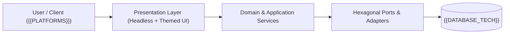

<!-- antigravity-doc-sync -->
# 🧩 {{PROJECT_NAME}} — Logical Architecture (`docs/architecture/LOGICAL_ARCHITECTURE.md`)

> **Index**: [`docs/INDEX.md`](../INDEX.md) · **Memory Baseline**: [`memory-bank/projectbrief.md`](../../memory-bank/projectbrief.md)

## 1. System Context & Domain North Star
- **Project**: **{{PROJECT_NAME}}** — {{PROJECT_TAGLINE}}
- **Target Platforms**: {{PLATFORMS}}
- **Core Architectural Pattern**: Three-Tier Memory Bank + Decoupled Zero-Token Backlog + Hexagonal Domain/Adapter Isolation.

---

## 2. Core Domain Entities & Shared Hexagonal Bricks

<!-- ag-section:logical-entities:start -->
| Module / Brick | Responsibility | Status |
| :--- | :--- | :--- |
| `core` | Primary domain logic and business invariants | 🟢 Active |
<!-- ag-section:logical-entities:end -->

---

## 3. Progressive Feature & Capability Map (`FEAT-*`)

<!-- ag-section:logical-features:start -->
_Progressive scaffold: automatically populated as `FEAT-*` backlog tickets are planned (`/backlog-plan`) and completed (`/backlog-start`)._
<!-- ag-section:logical-features:end -->

---

## 4. Consolidated Project Specifications

<!-- ag-section:legacy-logical:start -->
_No legacy logical architecture documents merged yet._
<!-- ag-section:legacy-logical:end -->
